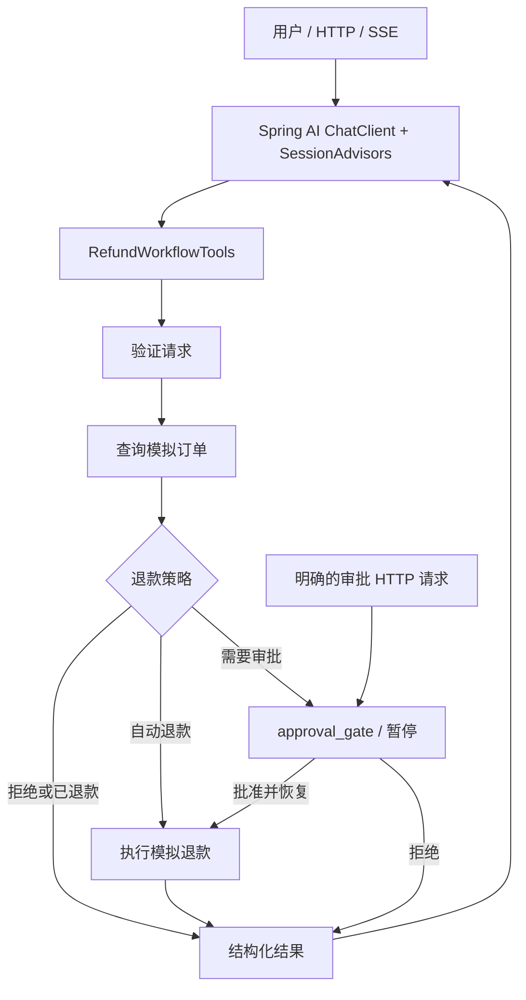

# Spring AI + LangGraph4j Refund Assistant

基于 Spring AI 与 LangGraph4j 的 Java AI 工作流示例，涵盖会话记忆、工具调用、人工审批、检查点恢复和 SSE 流式输出。

Java AI workflow examples with Spring AI and LangGraph4j, featuring conversation memory, tool calling, human approval, checkpoint recovery, and SSE streaming.

[中文](#中文) · [English](#english) · [0BSD License](LICENSE)

## 中文

以 Spring AI `ChatClient` 为对话入口，通过原生 `@Tool` 调用 LangGraph4j 退款工作流。聊天层负责会话记忆、信息追问和工具选择，图负责验证、查单、策略判断、人工审批与退款执行。另提供五个可独立运行的 Java Graph 示例。

订单和支付均为本地 mock，模型调用使用真实的 DeepSeek 兼容接口。启动无需数据库，本项目提供 HTTP/SSE API，没有附带网页前端。

### 功能与架构

- 普通聊天、会话记忆、多轮补齐订单号与退款原因。
- 原生工具调用启动退款工作流、查询退款状态。
- 类型化状态、条件路由、人工中断与明确审批恢复。
- HTTP 与 SSE，包含模型文本片段、工作流步骤与结构化结果。
- 请求重放、冲突检测、会话隔离、同订单流程复用与模拟支付幂等。
- 五个独立示例：Graph API、持久化与历史重放、持续运行、流式输出、子图。



Spring AI 聊天历史与 LangGraph4j 工作流 checkpoint 分开管理。聊天中的“同意”不会直接批准退款，审批必须通过独立接口提交 Boolean 决定。

### 与 Spring Statemachine 对照

参考：[《Spring Statemachine》官方文档](https://docs.spring.io/spring-statemachine/docs/current/reference/)。下表展示同一退款流程在两种编排方式中的实现思路。

不想用langgraph4j？试试看Spring Statemachine来实现图。

| 当前 LangGraph4j 实现 | Spring Statemachine 实现思路 |
| --- | --- |
| 查单、退款等节点 | `Action` 执行业务动作 |
| 条件边与政策判断 | `Guard`、`Choice` 条件分支 |
| `RefundState` 保存订单、审批等数据 | `ExtendedState` 或独立业务对象 |
| `approval_gate` 中断和恢复 | 停留在待审批状态，接收 `APPROVE` / `REJECT` 事件 |
| checkpoint 保存和恢复 | `StateMachinePersister` / `StateMachineRuntimePersister` |
| 节点事件推送 SSE | `Listener` / `Interceptor` 转换为现有 SSE 事件 |

### 技术版本

| 组件 | 项目版本 |
| --- | --- |
| Java | 25 |
| Maven | 3.9+ |
| Spring Boot | 4.1.0 |
| Spring AI | 2.1.0-RC1（候选版） |
| LangGraph4j | 1.9.7 |

依赖版本来自 [pom.xml](pom.xml)。

### 快速开始

安装 JDK 25、Maven 3.9+，进入项目根目录。先运行无需密钥的测试和示例：

```powershell
mvn clean verify
./scripts/run-graph-examples.ps1 -Example all -Offline
```

离线示例只替换模型，仍执行真实图、状态序列化和 checkpoint 逻辑。`-Offline` 适用于独立示例，HTTP 聊天服务需要配置真实模型。

PowerShell 启动服务：

```powershell
$env:DEEPSEEK_API_KEY = '<your-api-key>'
# 可选：以下地址和模型是代码中的默认值
$env:DEEPSEEK_BASE_URL = 'https://ark.cn-beijing.volces.com/api/v3'
$env:DEEPSEEK_MODEL = 'deepseek-v4-flash-ga-260731'
mvn spring-boot:run
```

Linux / macOS：

```bash
export DEEPSEEK_API_KEY='<your-api-key>'
export DEEPSEEK_BASE_URL='https://ark.cn-beijing.volces.com/api/v3'
export DEEPSEEK_MODEL='deepseek-v4-flash-ga-260731'
mvn spring-boot:run
```

| 环境变量 | 说明 | 默认值 |
| --- | --- | --- |
| `DEEPSEEK_API_KEY` | 提供方 API 密钥，聊天服务必须设置 | 无 |
| `DEEPSEEK_BASE_URL` | DeepSeek 兼容接口基础地址 | `https://ark.cn-beijing.volces.com/api/v3` |
| `DEEPSEEK_MODEL` | 提供方账户中可用的模型 ID | `deepseek-v4-flash-ga-260731` |
| `SERVER_PORT` | HTTP 服务端口 | `8080` |

提供方地址、模型 ID 和密钥需要相互匹配；可用模型取决于你的提供方账户。项目通过 Spring AI `DeepSeekChatModel` 请求 `/chat/completions`。配置见 [application.yml](src/main/resources/application.yml)，密钥仅从环境变量读取，没有硬编码密钥。项目不会自动加载 `.env` 文件。

### 完整退款示例

服务启动后，在另一个 PowerShell 终端执行：

```powershell
function Send-Json($Path, $Payload) {
    $json = $Payload | ConvertTo-Json -Depth 10
    Invoke-RestMethod ("http://localhost:8080" + $Path) -Method Post `
        -ContentType 'application/json; charset=utf-8' `
        -Body ([Text.Encoding]::UTF8.GetBytes($json))
}
$conversation = 'demo-' + [Guid]::NewGuid().ToString('N')

# 缺少订单号与原因：助手先追问
Send-Json '/api/chat' @{
    conversationId = $conversation; requestId = 'turn-1'
    message = '我想申请退款。'
}

# 补齐信息：O-2001 需要人工审批
$waiting = Send-Json '/api/chat' @{
    conversationId = $conversation; requestId = 'turn-2'
    message = '订单 O-2001，商品质量问题，请帮我办理退款。'
}
$waiting | ConvertTo-Json -Depth 12
$thread = $waiting.refunds[0].threadId

# 提交明确审批并恢复原流程
Send-Json "/api/chat/$conversation/refunds/$thread/approval" @{
    requestId = 'approval-1'; approved = $true
}

Invoke-RestMethod "http://localhost:8080/api/chat/$conversation/refunds"
```

聊天响应包含 `conversationId`、`requestId`、`answer`、`refunds`、`toolsCalled`。退款状态、金额与凭证以 `refunds` 结构化数据为准；`answer` 是模型生成的说明。

相同 `requestId` 与相同请求会重放已成功的结果；同一 ID 对应不同内容返回 409。一个会话中同一订单复用已有流程。缺少 `approved` 返回 400，跨会话访问退款不允许，重复审批已完成流程返回 409。

### HTTP 与 SSE

| 方法 | 路径 | 用途 |
| --- | --- | --- |
| POST | `/api/chat` | 聊天与工具调用 |
| POST | `/api/chat/stream` | 流式聊天与工作流事件 |
| GET | `/api/chat/{conversationId}/refunds` | 当前会话的退款结果 |
| POST | `/api/chat/{conversationId}/refunds/{threadId}/approval` | 明确审批与恢复 |
| POST | `/api/chat/{conversationId}/refunds/{threadId}/approval/stream` | 流式审批恢复 |
| GET | `/api/refunds/graph` | 退款图的 Mermaid 源码 |

SSE 与普通接口使用相同 JSON 请求体，事件包括 `token`、`workflow_step`、`workflow_result`、`approval_required`、`result`、`error`。`result` 为本轮完整响应。请求校验失败直接返回 HTTP 错误；流建立后的异常通过 `error` 事件发送。

### 模拟订单与规则

| 订单 | 场景 |
| --- | --- |
| `O-1001` | 99 元，签收 5 天，自动退款 |
| `O-2001` | 399 元，签收 3 天，有风控标记，需要审批 |
| `O-3001` | 签收 45 天，拒绝退款 |
| `O-4001` | 已退款，避免重复执行 |
| 其他订单号 | 未找到订单，拒绝退款 |

规则要求订单已支付、签收不超过 30 天；金额达到 300 元或有风控标记时需要审批。模拟账本在当前进程内共享，同一订单重复执行复用退款凭证。

### 代码与文档

```text
src/main/java/com/example/refunddemo/
  assistant/       ChatClient 编排、会话关联与模型可见工具
  config/          Spring AI 会话、工具循环、模型传输与图装配
  refund/
    schema/        类型化命令、状态、上下文和结果
    graph/         退款图与状态序列化
    nodes/         验证、查单、策略、审批、退款与结果节点
  tool/            模拟订单与支付工具
  web/             HTTP/SSE 接口与错误处理
  examples/        五个独立 Graph 示例与 CLI
src/test/          策略、工作流、工具、序列化与 HTTP/SSE 测试
docs/              中文系列文章、架构、运行说明与历史验证记录
scripts/           PowerShell 示例运行脚本
ref-source/        可选上游源码参考，不参与构建与 Git 提交
```

- [系列上篇](docs/blog/spring-ai-2-langgraph4j-01.md)：项目搭建、工具与会话、Graph API、持久化、中断恢复。
- [系列下篇](docs/blog/spring-ai-2-langgraph4j-02.md)：流式、子图、退款助手、审批、HTTP/SSE、测试。
- [五个 Graph 示例](docs/java-graph-examples.md)、[当前架构](docs/refund-architecture.md)、[分步说明](docs/langgraph4j-spring-ai-step-by-step.md)。
- [API 对照](docs/langgraph4j-spring-ai-refund-research.md)、[历史验证记录](docs/graph-examples-verification.md)、[上游源码获取说明](ref-source/README.md)。

### 验证与使用边界

```powershell
# 默认测试：无需真实 API Key
mvn clean verify

# 五个独立图示例：无需真实 API Key
./scripts/run-graph-examples.ps1 -Example all -Offline

# 真实提供方集成测试：先设置有效的 DEEPSEEK_API_KEY
mvn -Plive-graph verify
```

默认测试使用确定性模型，验证实际 Spring AI 工具循环、嵌入式 HTTP 服务和工作流行为。`live-graph` 才会调用真实提供方。PowerShell 脚本需要 PowerShell；其他系统可在安装 `pwsh` 后运行，或按[示例说明](docs/java-graph-examples.md)运行 Java CLI。

默认聊天会话、流程关联、请求缓存、MemorySaver 与模拟账本存于内存，重启后丢失。磁盘恢复由独立示例和测试演示。本示例未实现生产登录身份、订单归属授权、审批角色、分布式锁、持久化支付幂等或真实支付渠道；生产接入需要补齐这些能力。

### 许可证与凭据

项目原创代码采用 [BSD Zero Clause License（0BSD）](LICENSE)，这是 [OSI 批准的开源许可证](https://opensource.org/license/0bsd)。允许商用、修改、闭源和再分发，不要求保留版权声明或许可证文本。可选 `ref-source/` 中的第三方源码遵循各自上游许可证。API Key 请保留在环境变量或本机私有配置中；日志、检查点、IDE 文件、私有配置和密钥文件已列入 [.gitignore](.gitignore)。

## English

A conversational refund assistant built with Spring AI `ChatClient` and a LangGraph4j workflow invoked through native `@Tool` calls. The chat layer handles conversation memory, clarification and tool selection. The graph handles validation, order lookup, policy decisions, explicit human approval and refund execution. Five standalone Java graph examples are also included.

Orders and payments use local mocks. Model calls use a real DeepSeek-compatible provider. The application exposes HTTP/SSE APIs, has no bundled web frontend and requires no database.

### Features and architecture

- General chat, conversation memory and multi-turn collection of order IDs and refund reasons.
- Native tools for starting refund workflows and querying status.
- Typed state, conditional routing, human interruption and explicit approval/resume.
- HTTP and SSE with model tokens, workflow steps and structured results.
- Request replay, conflict detection, conversation isolation, workflow reuse and mock payment idempotency.
- Five graph examples: Graph API, persistence/history replay, durable execution, streaming and subgraphs.

The flow is `ChatClient + SessionAdvisors → RefundWorkflowTools → validation → order lookup → policy → approval when required → mock refund → result`. See the diagram above. Spring AI conversation history and LangGraph4j checkpoints are managed separately. A chat message saying “approve” does not authorize a refund; approval requires a separate HTTP request with a Boolean decision.

### Comparison with Spring Statemachine

Reference: [Spring Statemachine documentation](https://docs.spring.io/spring-statemachine/docs/current/reference/). The table maps the same refund workflow to the two orchestration approaches.

Prefer an alternative to LangGraph4j? Try implementing the graph with Spring Statemachine.

| Current LangGraph4j implementation | Spring Statemachine approach |
| --- | --- |
| Order lookup and refund nodes | Execute business operations through `Action` |
| Conditional edges and policy decisions | Use `Guard` and `Choice` branches |
| `RefundState` stores order and approval data | Use `ExtendedState` or a separate domain object |
| `approval_gate` interruption and resume | Remain in an approval-pending state until an `APPROVE` / `REJECT` event arrives |
| Checkpoint persistence and recovery | Use `StateMachinePersister` / `StateMachineRuntimePersister` |
| Node events forwarded through SSE | Adapt `Listener` / `Interceptor` callbacks into the existing SSE events |

### Versions

| Component | Project version |
| --- | --- |
| Java | 25 |
| Maven | 3.9+ |
| Spring Boot | 4.1.0 |
| Spring AI | 2.1.0-RC1 (release candidate) |
| LangGraph4j | 1.9.7 |

Dependencies are pinned in [pom.xml](pom.xml).

### Quick start

Install JDK 25 and Maven 3.9+, then run these commands from the project root. Tests and offline examples require no API key:

```powershell
mvn clean verify
./scripts/run-graph-examples.ps1 -Example all -Offline
```

Offline examples replace only the model; graph execution, serialization and checkpoints still run. `-Offline` applies to standalone examples. The HTTP chat service requires a real model configuration.

Start the service in PowerShell:

```powershell
$env:DEEPSEEK_API_KEY = '<your-api-key>'
# Optional overrides; these match the current code defaults.
$env:DEEPSEEK_BASE_URL = 'https://ark.cn-beijing.volces.com/api/v3'
$env:DEEPSEEK_MODEL = 'deepseek-v4-flash-ga-260731'
mvn spring-boot:run
```

Linux / macOS:

```bash
export DEEPSEEK_API_KEY='<your-api-key>'
export DEEPSEEK_BASE_URL='https://ark.cn-beijing.volces.com/api/v3'
export DEEPSEEK_MODEL='deepseek-v4-flash-ga-260731'
mvn spring-boot:run
```

| Environment variable | Purpose | Default |
| --- | --- | --- |
| `DEEPSEEK_API_KEY` | Provider API key; required for the chat service | None |
| `DEEPSEEK_BASE_URL` | Base URL of the DeepSeek-compatible provider | `https://ark.cn-beijing.volces.com/api/v3` |
| `DEEPSEEK_MODEL` | Model ID available to your provider account | `deepseek-v4-flash-ga-260731` |
| `SERVER_PORT` | HTTP port | `8080` |

Use a matching provider URL, model ID and API key. Model availability depends on your provider account. The project uses Spring AI `DeepSeekChatModel` to call `/chat/completions`. See [application.yml](src/main/resources/application.yml). The key comes from the environment and has no hardcoded default. `.env` files are not loaded automatically.

### End-to-end refund example

With the service running, open a second PowerShell terminal:

```powershell
function Send-Json($Path, $Payload) {
    $json = $Payload | ConvertTo-Json -Depth 10
    Invoke-RestMethod ("http://localhost:8080" + $Path) -Method Post `
        -ContentType 'application/json; charset=utf-8' `
        -Body ([Text.Encoding]::UTF8.GetBytes($json))
}
$conversation = 'demo-' + [Guid]::NewGuid().ToString('N')

# Missing details: the assistant asks for the order ID and reason.
Send-Json '/api/chat' @{
    conversationId = $conversation; requestId = 'turn-1'
    message = 'I would like a refund.'
}

# O-2001 requires human approval.
$waiting = Send-Json '/api/chat' @{
    conversationId = $conversation; requestId = 'turn-2'
    message = 'Order O-2001 has quality issues. Please request a refund.'
}
$waiting | ConvertTo-Json -Depth 12
$thread = $waiting.refunds[0].threadId

# Submit an explicit decision and resume the existing workflow.
Send-Json "/api/chat/$conversation/refunds/$thread/approval" @{
    requestId = 'approval-1'; approved = $true
}

Invoke-RestMethod "http://localhost:8080/api/chat/$conversation/refunds"
```

Chat responses contain `conversationId`, `requestId`, `answer`, `refunds` and `toolsCalled`. Use structured `refunds` data for refund status, amounts and receipts; `answer` is the model's explanation.

Reusing a `requestId` with the same request replays the successful result; different content with the same ID returns 409. A conversation reuses the existing workflow for the same order. Missing `approved` returns 400, cross-conversation refund access is rejected, and approving an already completed workflow returns 409.

### HTTP and SSE

| Method | Path | Purpose |
| --- | --- | --- |
| POST | `/api/chat` | Chat and tool calls |
| POST | `/api/chat/stream` | Streaming chat and workflow events |
| GET | `/api/chat/{conversationId}/refunds` | Refund results for a conversation |
| POST | `/api/chat/{conversationId}/refunds/{threadId}/approval` | Explicit approval and resume |
| POST | `/api/chat/{conversationId}/refunds/{threadId}/approval/stream` | Streaming approval and resume |
| GET | `/api/refunds/graph` | Refund graph as Mermaid source |

SSE endpoints accept the same JSON bodies as their non-streaming counterparts. Events include `token`, `workflow_step`, `workflow_result`, `approval_required`, `result` and `error`. `result` contains the complete turn response. Validation failures return HTTP errors; errors after the stream opens are emitted as `error` events.

### Mock orders and policy

| Order | Scenario |
| --- | --- |
| `O-1001` | CNY 99, delivered 5 days ago; automatic refund |
| `O-2001` | CNY 399, delivered 3 days ago, risk flag; approval required |
| `O-3001` | Delivered 45 days ago; refund rejected |
| `O-4001` | Already refunded; no duplicate payment |
| Any other ID | Order not found; refund rejected |

The policy requires a paid order delivered within 30 days. Amounts of CNY 300 or more, or a risk flag, require approval. The mock ledger is shared within the process and reuses the existing refund receipt for repeated execution of the same order.

### Source and documentation

Under `src/main/java/com/example/refunddemo/`, `assistant/` handles chat and workflow tools, `config/` wires the application, `refund/` contains typed state and graph nodes, `tool/` provides order/payment mocks, `web/` exposes HTTP/SSE, and `examples/` contains the graph CLI. Tests are under `src/test/`.

The detailed articles are currently in Chinese:

- [Part 1](docs/blog/spring-ai-2-langgraph4j-01.md): setup, tools, sessions, Graph API, persistence and interruption/resume.
- [Part 2](docs/blog/spring-ai-2-langgraph4j-02.md): streaming, subgraphs, refund integration, approvals, HTTP/SSE and testing.
- [Graph examples](docs/java-graph-examples.md), [architecture](docs/refund-architecture.md), [step-by-step guide](docs/langgraph4j-spring-ai-step-by-step.md).
- [API research](docs/langgraph4j-spring-ai-refund-research.md), [historical verification](docs/graph-examples-verification.md), [optional upstream source setup](ref-source/README.md).

Optional upstream source directories under `ref-source/` are excluded from the build and Git commits. Follow their README to obtain them after cloning this repository.

### Verification and scope

```powershell
# Deterministic tests: no real provider key required.
mvn clean verify

# All five standalone graph examples without provider calls.
./scripts/run-graph-examples.ps1 -Example all -Offline

# Real provider integration: set a valid DEEPSEEK_API_KEY first.
mvn -Plive-graph verify
```

Default tests use a deterministic model while exercising the actual Spring AI tool loop, embedded HTTP server and workflows. Only the `live-graph` profile calls a real provider. The example script requires PowerShell; on other systems install `pwsh` or run the Java CLI as described in the [examples guide](docs/java-graph-examples.md).

By default, chat sessions, workflow associations, request caches, MemorySaver checkpoints and the mock ledger are held in memory and lost on restart. Standalone examples and tests demonstrate disk checkpoint recovery. Production identity, order ownership checks, approval roles, distributed locking, durable payment idempotency and real payment integration must be supplied separately.

### License and credentials

Original project code is licensed under the [BSD Zero Clause License (0BSD)](LICENSE), an [OSI-approved open source license](https://opensource.org/license/0bsd). Commercial use, modification, closed-source use and redistribution are permitted, with no requirement to retain copyright notices or license text. Optional third-party sources under `ref-source/` retain their upstream licenses. Keep API keys in environment variables or local private configuration. [.gitignore](.gitignore) excludes logs, checkpoints, IDE metadata, private configuration and key files.
