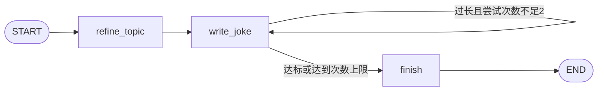
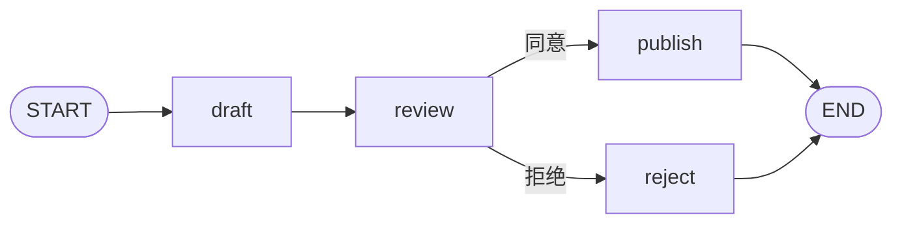

# 《spring ai 2 + LangGraph4j》系列教程（上）：从零建项目到可恢复的 Java Graph

你可能已经用 Spring AI 写过一个聊天接口：接收一句话，调用模型，再返回一句话。接下来，用户希望助手查订单、申请退款、等待审批，还希望服务重启以后继续处理。此时需要同时解决两件事：让模型理解对话，让程序可靠地推进业务。

这个系列使用一个 Java 项目，把两件事逐步组合起来。先写最小聊天调用，再写第一张图，接着学习状态、条件分支、持久化和恢复，最后实现“聊天助手通过工具调用退款图”。

本文是上篇；[下篇：流式、子图与完整退款助手](spring-ai-2-langgraph4j-02.md)继续讲解流式输出、子图、人工审批、HTTP/SSE 和工程化验证。两篇可以依次阅读，也可以按章节拆成博客连载。

## 阅读约定与版本

本教程对应这个开源项目的已验证组合：

| 组件 | 本文版本 | 用途 |
| --- | --- | --- |
| Java | 25 | 应用和 CLI 运行环境 |
| Maven | 3.9+ | 依赖管理与构建 |
| Spring Boot | 4.1.0 | Web 服务、配置和依赖注入 |
| Spring AI | **2.1.0-RC1** | 模型、原生工具调用、Session 会话 |
| LangGraph4j | **1.9.7** | 状态图、checkpoint、中断、恢复和子图 |

`RC1` 是候选发布版。这里明确锁定版本，不把它写成已发布的 `2.1.0` 正式版，也不承诺未来版本的 API 完全相同。项目的 [pom.xml](../../pom.xml) 是依赖版本的依据。

系列围绕五项核心能力展开：Graph API、持久化、持续运行、流式输出、子图。每一项都先解释要解决的问题，再给出 Java 实现，最后说明如何运行和验证。阅读只需要本系列文章和本项目源码。

文中的代码分为三类：

- **完整示例**：可以按指定文件名直接保存、编译。
- **源码摘录/学习片段**：省略 import、装配或其他节点；可在链接的源文件中查看完整实现。
- **设计伪代码**：解释业务设计，不能当作框架原生 API 直接粘贴运行。

所有源码链接都相对于本仓库，可在 Git 平台和本地 Markdown 阅读器中打开。若希望查看完整实现，优先跟随每节结尾的源码链接。

### 先跑通，再读源码

第一次阅读时，建议先用离线模式完成实验。你不需要先申请模型 key，也不需要启动 Web 服务或数据库：

```powershell
# 在项目根目录执行；使用 JDK 25，Maven 3.9+
./scripts/run-graph-examples.ps1 -Example graph-api -Offline
```

脚本会先编译、计算依赖 classpath，再运行 `GraphExamples.main()`。`-Offline` 表示使用项目内的 `OfflineChatModel`，它替代外部模型服务，**不是 Maven 的离线依赖模式**。首次执行仍可能下载 Maven 依赖。

运行成功后会看到 Mermaid 图定义、`status`、`topic`、笑话正文和 `trace`。这时先找 `trace`：它记录实际执行了哪些节点，比模型回答的措辞更能说明图是否按预期运行。

| 阅读阶段 | 先回答什么问题 | 对应源码 |
| --- | --- | --- |
| 第 3 讲 | 一次模型请求如何发出？工具调用如何回来？ | `AssistantConfig` |
| 第 4 讲 | 一份数据如何经过节点、合并更新、选择分支？ | `LearningState`、`GraphApiExample` |
| 第 5 讲 | 如何找到一次执行以及其中的某个历史位置？ | `PersistenceExample` |
| 第 6 讲 | 进程结束后，如何带着人的决定继续？ | `DurableExecutionExample` |

每个实验都按“输入 → 节点返回的更新 → 合并后的状态 → 下一节点 → 观察结果”阅读。暂时不理解的框架类型，可以先回到这五步定位它的作用。文中的固定文本只用于解释数据变化，真实模型不保证生成相同句子。

## 第 1 讲：先分清 Spring AI 和 LangGraph4j

假设用户说：“O-2001 买错了，帮我退款。”

Spring AI 负责把自然语言、历史对话和工具定义交给模型，并执行模型请求的工具。LangGraph4j 负责按预先定义的节点、边和状态推进退款。

```text
用户消息
  → Spring AI ChatClient：理解意图、追问、选择工具
  → start_refund_workflow：结构化业务入口
  → LangGraph4j：查订单 → 校验规则 → 审批 → 执行退款
  → 结构化结果
  → Spring AI：向用户解释结果
```

这里并不要求每个图节点都调用模型。检查订单是否超过 30 天，用 Java 比较时间就足够；计算退款金额，也应使用业务数据和 `BigDecimal`。在写笑话、理解文本等任务中，节点再调用 `ChatClient`。

两种入口结构都成立：

| 结构 | 适合的情况 | 需要关注 |
| --- | --- | --- |
| 用户 → 图 → 图节点调用 Spring AI | 任务有明确阶段，整个处理路径需要统一编排 | 普通聊天、追问也需要设计相应路由 |
| 用户 → Spring AI → 工具 → 业务图 | 通用助手同时提供咨询和多种业务能力 | 模型选工具具有不确定性，业务规则仍需服务端校验 |

本项目的主应用采用第二种；五个独立 Graph 示例则演示第一种中的“图节点调用模型”。两者放在同一项目，可以帮助你理解它们如何组合。

### 1.1 为什么不把所有步骤写在一个方法里

只做“查订单，然后退款”，普通 Java 方法当然可以实现。问题出现在方法执行到一半时：用户还没有审批，HTTP 请求应该返回什么？服务重启后该从哪里继续？支付成功但响应丢失，再点一次会怎样？

状态图把这些问题变成可检查的数据：订单信息保存在哪个字段，下一步是哪个节点，流程是否需要人工决定，以及恢复时哪些工作可以复用。图不会自动替你实现业务事务；它提供执行结构和保存执行进度的机制。

可以把一次运行想成“带着一份表单沿办理步骤前进”。State 是表单内容，Node 是办理步骤，Edge 是转交规则，Checkpoint 是办理到某个位置时保存的表单和位置。这个类比只用于入门：Java 中 State 由 Map 和类型化 getter 表达，节点返回局部更新，不需要原地改同一个表单对象。

### 1.2 一次聊天与一笔业务流程的时间跨度

```text
第 1 轮：用户提供订单号 → 助手追问原因                 没有退款图
第 2 轮：用户补充原因 → 启动退款图 → 返回待审批         图停在审批前
过了十分钟：用户点击批准 → 恢复原退款图 → 返回退款结果   沿用原 threadId
第 3 轮：用户询问进度 → 助手查询原退款流程              不创建新图
```

一次聊天可能不启动图，也可能关联多个订单的图；一张图也可能跨多个请求继续。因此后面会分别使用 `conversationId`、`threadId` 和 `requestId`，不能用一个“聊天 ID”承担所有职责。

## 第 2 讲：从一个空目录创建项目

### 2.1 准备目录

新建一个 Maven 项目，目录如下：

```text
spring-ai-graph-demo/
  pom.xml
  src/main/java/com/example/refunddemo/
    RefundDemoApplication.java
  src/main/resources/
    application.yml
  src/test/java/com/example/refunddemo/
```

在终端执行 `java -version` 和 `mvn -version`。本项目使用 Java 25；如果 Maven 显示的 Java 版本不一致，先修正 `JAVA_HOME` 和 PATH，再排查编译错误。

### 2.2 添加依赖

下面是可以用于新建项目的完整基础 POM。完整仓库还配置了真实模型集成测试 profile，后面会介绍。

```xml
<?xml version="1.0" encoding="UTF-8"?>
<project xmlns="http://maven.apache.org/POM/4.0.0"
         xmlns:xsi="http://www.w3.org/2001/XMLSchema-instance"
         xsi:schemaLocation="http://maven.apache.org/POM/4.0.0 https://maven.apache.org/xsd/maven-4.0.0.xsd">
    <modelVersion>4.0.0</modelVersion>
    <parent>
        <groupId>org.springframework.boot</groupId>
        <artifactId>spring-boot-starter-parent</artifactId>
        <version>4.1.0</version>
        <relativePath/>
    </parent>
    <groupId>com.example</groupId>
    <artifactId>spring-ai-graph-demo</artifactId>
    <version>0.0.1-SNAPSHOT</version>
    <properties>
        <java.version>25</java.version>
        <spring-ai.version>2.1.0-RC1</spring-ai.version>
        <langgraph4j.version>1.9.7</langgraph4j.version>
    </properties>
    <dependencyManagement>
        <dependencies>
            <dependency>
                <groupId>org.springframework.ai</groupId>
                <artifactId>spring-ai-bom</artifactId>
                <version>${spring-ai.version}</version>
                <type>pom</type>
                <scope>import</scope>
            </dependency>
        </dependencies>
    </dependencyManagement>
    <dependencies>
        <dependency>
            <groupId>org.springframework.boot</groupId>
            <artifactId>spring-boot-starter-web</artifactId>
        </dependency>
        <dependency>
            <groupId>org.springframework.boot</groupId>
            <artifactId>spring-boot-starter-validation</artifactId>
        </dependency>
        <dependency>
            <groupId>org.springframework.boot</groupId>
            <artifactId>spring-boot-jackson2</artifactId>
        </dependency>
        <dependency>
            <groupId>org.springframework.ai</groupId>
            <artifactId>spring-ai-client-chat</artifactId>
        </dependency>
        <dependency>
            <groupId>org.springframework.ai</groupId>
            <artifactId>spring-ai-session-advisor</artifactId>
        </dependency>
        <dependency>
            <groupId>org.springframework.ai</groupId>
            <artifactId>spring-ai-starter-model-deepseek</artifactId>
        </dependency>
        <dependency>
            <groupId>org.bsc.langgraph4j</groupId>
            <artifactId>langgraph4j-core</artifactId>
            <version>${langgraph4j.version}</version>
        </dependency>
        <dependency>
            <groupId>org.bsc.langgraph4j</groupId>
            <artifactId>langgraph4j-spring-ai</artifactId>
            <version>${langgraph4j.version}</version>
        </dependency>
        <dependency>
            <groupId>org.springframework.boot</groupId>
            <artifactId>spring-boot-starter-test</artifactId>
            <scope>test</scope>
        </dependency>
    </dependencies>
    <build>
        <plugins>
            <plugin>
                <groupId>org.springframework.boot</groupId>
                <artifactId>spring-boot-maven-plugin</artifactId>
            </plugin>
        </plugins>
    </build>
</project>
```

为什么有 `spring-boot-jackson2`？本项目使用的 LangGraph4j Spring AI 状态序列化适配器仍依赖 Jackson 2，而 Spring AI 2.x 的一些组件使用 Jackson 3。两个包名体系不同，不应仅根据类名把所有 `ObjectMapper` import 替换掉。后面的序列化章节会解释具体处理。

先按职责理解依赖，暂时不必逐个背 artifactId：

| 依赖 | 在本项目中做什么 | 什么时候会用到 |
| --- | --- | --- |
| `spring-ai-client-chat` | 提供 ChatClient 调用入口 | 组织提示词、消息、工具 |
| `spring-ai-starter-model-deepseek` | 创建具体 ChatModel，访问模型服务 | 真实模型请求 |
| `spring-ai-session-advisor` | 加载和记录聊天会话 | 多轮聊天 |
| `langgraph4j-core` | StateGraph、节点、边、checkpoint | 编排与恢复 |
| `langgraph4j-spring-ai` | Spring AI 消息序列化、流式适配等 | 在图中使用 Spring AI |

BOM 在 `dependencyManagement` 中统一规定 Spring AI 版本；它本身不会把所有 Spring AI 模块加入应用。真正要使用的模块仍需写在 `dependencies` 中。LangGraph4j 使用另一套版本号，所以这里单独指定 `1.9.7`。

### 2.3 添加启动类和模型配置

完整启动类 `RefundDemoApplication.java`：

```java
package com.example.refunddemo;

import org.springframework.boot.SpringApplication;
import org.springframework.boot.autoconfigure.SpringBootApplication;

@SpringBootApplication
public class RefundDemoApplication {
    public static void main(String[] args) {
        SpringApplication.run(RefundDemoApplication.class, args);
    }
}
```

模型配置片段：

```yaml
spring:
  ai:
    model:
      chat: deepseek
    deepseek:
      api-key: ${DEEPSEEK_API_KEY:}
      base-url: ${DEEPSEEK_BASE_URL:https://ark.cn-beijing.volces.com/api/v3}
      chat:
        model: ${DEEPSEEK_MODEL:deepseek-v4-flash-ga-260731}
        thinking:
          type: disabled
        max-tokens: 1024
server:
  port: ${SERVER_PORT:8080}
```

这是本文验证的兼容接口地址和模型名。切换服务商时，应同时核实 base URL、模型标识、工具调用和流式协议兼容性。不能只更换 key，就假设其他服务支持全部参数。

PowerShell 启动：

```powershell
$env:DEEPSEEK_API_KEY = '<你的 API key>'
$env:DEEPSEEK_BASE_URL = 'https://ark.cn-beijing.volces.com/api/v3'
$env:DEEPSEEK_MODEL = 'deepseek-v4-flash-ga-260731'
mvn spring-boot:run
```

key 只放在环境变量或受保护的部署配置中，不写进 YAML 默认值。本文代码不会输出 key。

源码参考：[应用配置](../../src/main/resources/application.yml)、[Spring 装配](../../src/main/java/com/example/refunddemo/config/RefundDemoConfig.java)。仓库为普通调用和流式调用统一配置了 JDK HTTP 客户端，使用系统 DNS、HTTP/1.1 和连接超时。

### 2.4 先确认自己运行的是哪一种入口

本项目有两个入口，运行方式和所需环境不同：

| 入口 | 命令 | 观察什么 |
| --- | --- | --- |
| 独立 Graph CLI | `./scripts/run-graph-examples.ps1 -Example graph-api -Offline` | 终端里的图、状态和执行轨迹 |
| Spring Boot 主服务 | `mvn spring-boot:run` | HTTP 聊天、工具调用和 SSE；需要配置模型 key |

`GraphExamples` 手工创建 ChatClient，不会启动 Spring 容器；`RefundDemoApplication` 才会扫描 Bean、读取 YAML、启动 HTTP 服务。CLI 的 `-Offline` 开关不会改变 Web 服务使用的模型。

Windows 上如果 Maven 没有加入 PATH，可以给脚本传安装位置：

```powershell
$mavenCommand = 'C:\你的Maven目录\bin\mvn.cmd'
./scripts/run-graph-examples.ps1 -Example graph-api -Offline -Maven $mavenCommand
```

如果 `java -version` 是 25，`mvn -version` 却显示 17，说明两个命令选取了不同的 JDK。`release version 25 not supported` 应先检查工具环境；HTTP 401 应检查模型服务凭据；找不到模型名称应检查提供方配置。这三类问题尚未涉及图的路由逻辑。

## 第 3 讲：先理解一个 Spring AI 助手

### 3.1 ChatModel、ChatClient 和 Advisor

`ChatModel` 对接具体模型提供方；`ChatClient` 提供组织提示词、消息、工具、流式输出的调用入口；Advisor 在请求经过模型前后处理会话、工具循环等逻辑。

最小学习片段，假设 `model` 是 Spring 注入的 `ChatModel`：

```java
ChatClient client = ChatClient.builder(model).build();
String answer = client.prompt()
        .system("你是一个中文学习助手。")
        .user("用一句话解释状态图。")
        .call()
        .content();
```

这只代表一次请求。模型不会因为你复用了同一个 Java `ChatClient` 对象，就自动记住上次消息。记忆要由应用显式配置。

逐行看这个调用：`builder(model)` 选择提供方，`prompt()` 创建本轮请求，`system()` 指定助手行为，`user()` 加入用户消息，`call()` 选择普通调用，`content()` 取出文本。它们没有定义任何 Graph 节点或 checkpoint。

`String` 适合直接显示答案，但会丢掉部分结构。如果接下来需要保存模型消息，应读取 `.call().chatResponse()`，再从响应中取得输出 `AssistantMessage`。本项目写作节点使用后一种方式，同时保存正文与消息，供重写和序列化实验使用。

另外，提示词里的“最多 80 字”只是要求，模型可能超出。后面的图会用 Java 检查 `String.length()` 并决定是否重写。这个计数是 Java 字符串长度，遇到某些 emoji 不等于用户看到的字符个数，也不是模型 token 数；这里用它演示确定性的业务检查。

### 3.2 工具是业务能力的入口

先用一个无副作用的工具理解机制。学习片段：

```java
class PolicyTools {
    @Tool(description = "查询本演示的退款期限和审批规则")
    String refundPolicy() {
        return "已支付订单签收不超过30天可申请；金额达到300元或有风控标记时需要审批。";
    }
}

String answer = client.prompt()
        .user("你们的退款规则是什么？")
        .tools(new PolicyTools())
        .call()
        .content();
```

工具描述交给模型。模型可能返回“调用 refundPolicy”而不是普通文字；Spring AI 找到对应工具并执行，再把结果交给模型组织回答。

```text
消息 + 工具定义 → 模型请求调用工具
               → Spring AI 执行 Java 方法
               → 工具结果加入上下文
               → 模型生成最终回答
```

在本文版本中，ChatClient 的工具循环由 `ToolCallingAdvisor` 管理。通常不需要再自己写一套 `while` 循环。工具注册也不是调用保证：如果用户点击的是明确的业务按钮，后端可以直接调用业务服务，无需让模型再决定一次是否执行。

更具体地说，一次前端请求可能触发两次或更多次模型请求：

```text
第 1 次模型请求：用户问题 + refundPolicy 的名称、说明、参数 schema
第 1 次模型响应：ToolCall(name=refundPolicy, arguments={})
框架在应用中执行：PolicyTools.refundPolicy()
第 2 次模型请求：原消息 + 工具调用消息 + 工具执行结果
第 2 次模型响应：适合给用户阅读的中文答案
```

模型生成的是工具名称和参数，Java 方法实际在应用进程中执行。`@Tool` 的说明用于帮助模型选择；参数是否合法、用户能否执行、重复请求如何处理，仍由服务端判断。不要把“模型选择正确工具”理解为“工具执行必然成功”。

这里 `@Tool` 来自 `org.springframework.ai.tool.annotation.Tool`，不是 LangChain4j 的同名注解。工程名称中即使出现 langchain4j，也应以当前 POM 和 import 为准。

### 3.3 Spring AI 2.1 的会话

本项目使用 `SessionService` 和 `SessionAdvisors`。下面是装配学习片段，完整类见 [AssistantConfig](../../src/main/java/com/example/refunddemo/config/AssistantConfig.java)：

```java
SessionService sessions = DefaultSessionService.builder()
        .sessionRepository(InMemorySessionRepository.builder().build())
        .build();

ChatClient client = ChatClient.builder(model)
        .defaultAdvisors(SessionAdvisors.builder(sessions).build())
        .build();

String reply = client.prompt()
        .user("我的代号是蓝鲸42，请记住。")
        .advisors(SessionAdvisors.session("conversation-001"))
        .call().content();
```

下一轮继续使用同一会话 ID，才会加载同一份会话记录。切换 ID 应隔离历史。生产应用还要验证 ID 属于当前登录用户，不能把可猜测的会话 ID 当作身份认证。

本演示使用内存 repository，所以应用重启后聊天记录丢失。会话记忆和图 checkpoint 是不同的数据：前者保存聊过什么，后者保存流程走到哪里。

本版本已经提供新的 Session 机制。不要把其他版本教程里的 `MessageChatMemoryAdvisor`、手写消息列表和 SessionAdvisors 同时套上去，否则可能重复注入历史。

### 3.4 用两轮消息理解会话记忆

下面接着 3.3 的 `client` 执行，是学习片段：

```java
// 与上一轮相同 ID：Session Advisor 加载“我的代号是蓝鲸42”等历史。
String sameSession = client.prompt()
        .user("我的代号是什么？")
        .advisors(SessionAdvisors.session("conversation-001"))
        .call().content();

// 不同 ID：查找另一份历史，而不是继续 conversation-001。
String otherSession = client.prompt()
        .user("我的代号是什么？")
        .advisors(SessionAdvisors.session("conversation-002"))
        .call().content();
```

可观察的预期是：同会话能够根据历史回答代号，另一会话不应获得前一会话的内容。模型具体措辞不固定，所以测试应检查是否泄漏事实，而非要求回答整句完全一致。

官方 Session 机制把消息等内容记为事件，再构建模型看到的历史视图；不是让模型永久保存你的 Java 对象。该版本要求每次请求都指定 session ID，没有一个可安全共用的默认会话。未来如果配置历史压缩，压缩改变的是读取视图，不能因此认为业务 checkpoint 也被压缩或删除。

官方对照：[ChatClient 工具循环](https://github.com/spring-projects/spring-ai/blob/v2.1.0-RC1/spring-ai-docs/src/main/antora/modules/ROOT/pages/api/chatclient.adoc)、[工具调用](https://github.com/spring-projects/spring-ai/blob/v2.1.0-RC1/spring-ai-docs/src/main/antora/modules/ROOT/pages/api/tools.adoc)、[Session Memory](https://github.com/spring-projects/spring-ai/blob/v2.1.0-RC1/spring-ai-docs/src/main/antora/modules/ROOT/pages/api/session.adoc)。

## 第 4 讲：Graph API——从第一张图开始

### 4.1 三个概念：State、Node、Edge

先看最简单的“主题 → 文本”流程：

```text
START → write → END
```

- **State**：节点共享的执行数据，例如 `topic`、`joke`。
- **Node**：读取状态，完成工作，返回需要修改的字段。
- **Edge**：定义接下来运行哪个节点。

图是有向图，不是可视化图片本身。图片只是帮助我们理解实际执行定义。

### 4.2 一张不依赖模型的完整图

下面是完整示例 `HelloGraph.java`，可以放到已有 Maven 工程的 `src/main/java`，使用 IDE 运行 main。先不接模型，减少变量。

```java
import org.bsc.langgraph4j.GraphInput;
import org.bsc.langgraph4j.RunnableConfig;
import org.bsc.langgraph4j.StateGraph;
import org.bsc.langgraph4j.state.AgentState;

import java.util.Map;

import static org.bsc.langgraph4j.GraphDefinition.START;
import static org.bsc.langgraph4j.GraphDefinition.END;
import static org.bsc.langgraph4j.action.AsyncNodeAction.node_async;

public class HelloGraph {
    public static void main(String[] args) throws Exception {
        // 1. AgentState::new 告诉框架怎样从状态 Map 创建可读取的状态对象。
        var graph = new StateGraph<AgentState>(AgentState::new)
                .addNode("write", node_async(state -> {
                    // 2. 读取输入；orElseThrow 表示缺少 topic 就明确报错。
                    String topic = state.<String>value("topic").orElseThrow();
                    // 3. 仅返回变化字段：topic 不会因为未出现在返回值中而消失。
                    return Map.of("joke", "程序员给" + topic + "写了一个接口。");
                }))
                // 4. START/END 是框架的入口/出口标记，不是需要实现的业务节点。
                .addEdge(START, "write")
                .addEdge("write", END)
                // 5. 编译定义；此时尚未运行 write 节点。
                .compile();

        // 6. 开始一次新执行，并等待它结束；本例没有配置持久化。
        var result = graph.invoke(GraphInput.args(Map.of("topic", "猫")), RunnableConfig.empty())
                .orElseThrow();
        System.out.println(result.<String>value("joke").orElseThrow());
    }
}
```

`compile()` 把构建定义转为可执行图，并检查图结构。输入通过 `GraphInput.args(...)` 传入。无初始参数的新执行可用 `GraphInput.noArgs()`；恢复旧执行使用 `GraphInput.resume()`，三者不要混淆。

节点返回的是 `joke` 的更新，不必返回整个 state。原来的 `topic` 仍然保留。

#### 4.2.1 跟着一份状态走完整个过程

| 时间点 | 本次输入或节点返回值 | 框架合并后的状态 |
| --- | --- | --- |
| 调用图 | `{topic: "猫"}` | `{topic: "猫"}` |
| write 返回 | `{joke: "程序员给猫写了一个接口。"}` | `{topic: "猫", joke: "程序员给猫写了一个接口。"}` |
| 到达 END | 没有新业务更新 | 保留上一步状态，作为最终结果 |

所以 `result.value("topic")` 仍能取到“猫”，`result.value("joke")` 才是新生成的文本。`invoke()` 返回 `Optional`；这个最小图预期有结果，所以使用 `orElseThrow()` 显式拒绝“没有结果”。

新手常问 `state.<String>value("topic")` 的点号后为什么有类型参数。因为 State 内部存的是 `Object`，这里告诉 Java 本次期望读取 String。它不等于 JSON Schema 验证；如果写入的是数字，类型约定仍会出错。实际业务用常量、getter、命令 DTO 约束读写。

`state -> {...}` 是 lambda 节点函数；`node_async` 把同步函数适配成框架要求的异步接口。它没有把你的阻塞 HTTP 请求自动改为非阻塞，也没有单独配置一个业务线程池。

#### 4.2.2 为什么每次返回新 Map

推荐把节点写成“读取快照 → 计算 → 返回更新”。不要对 `state.data()` 或其中的可变 List 原地增删，再试图让框架猜发生了什么。明确返回更新，框架才知道哪些字段需要经过 channel 合并。

`Map.of(...)` 和 `List.of(...)` 创建的集合不可修改，且不接受 null。没有订单时可以不返回 `order` 字段，或用显式业务状态表示；不要写 `Map.of("order", null)`，那会先抛 `NullPointerException`，还没有进入任何 reducer。

第一张图不需要自定义 State 类。字段增多后，把 `"topic"` 抽为 `LearningState.TOPIC`，再提供 `topic()`、`attempts()` 等 getter，可以减少字符串拼写错误，让节点只关注它实际使用的业务字段。

### 4.3 接入模型，做一个会修改笑话的图

把上一节固定文本的节点替换为 `ChatClient` 调用，然后增加主题细化和长度检查：



核心源码摘录：

```java
.addNode("write_joke", node_async(state -> {
    UserMessage request = new UserMessage("写一个关于「" + state.topic() + "」的简短笑话。");
    var answer = client.prompt()
            .messages(state.messages()).messages(request)
            .call().chatResponse().getResult().getOutput();
    return Map.of(
            LearningState.JOKE, answer.getText(),
            LearningState.ATTEMPTS, state.attempts() + 1,
            LearningState.MESSAGES_STATE, List.<Message>of(request, answer),
            LearningState.TRACE, List.of("write_joke"));
}))
```

真实实现还给模型提示长度限制，并处理空响应。模型生成文本，Java 检查是否符合长度要求。超过两次仍不满足时返回 `LIMIT_REACHED`，不会偷偷把失败结果写成成功。

完整源码：[GraphApiExample](../../src/main/java/com/example/refunddemo/examples/GraphApiExample.java)。运行：

```powershell
./scripts/run-graph-examples.ps1 -Example graph-api -Topic '程序员与猫'
```

先加 `-Offline` 观察固定结果，再去掉它运行真实模型。同一张图在两种模式下使用相同的节点、边和状态合并逻辑，替换的只是模型提供方。

#### 4.3.1 把循环展开一次

假设 `maxCharacters=80`，第一次生成 100 字符，第二次生成 60 字符：

| 刚完成的节点 | 状态更新重点 | 条件边如何判断 | 下一步 |
| --- | --- | --- | --- |
| refine_topic | topic 被细化；trace 追加一次 | 固定边 | write_joke |
| 第一次 write_joke | joke=100 字符；attempts=1；追加两条消息 | `100 > 80 && 1 < 2` 为 true | 再次 write_joke |
| 第二次 write_joke | joke 覆盖为 60 字符；attempts=2；再追加两条消息 | 长度已达标 | finish |
| finish | status=ACCEPTED | 固定边 | END |

最终 `trace` 应是 `[refine_topic, write_joke, write_joke, finish]`。`attempts` 是累计写作次数，`joke` 只保存最后一版；`messages` 保留两轮写作的问答，供第二次请求看到前次文本。

如果第二次仍是 100 字符，条件边也会去 `finish`，但状态是 `LIMIT_REACHED`。这表示“尝试结束但质量条件未满足”，调用方应据此提示或转人工，不能把到达 END 一律解释成业务成功。

### 4.4 Reducer：一个字段收到更新后怎么合并

假设旧状态是 `attempts=1`、`trace=[write_joke]`，节点返回 `attempts=2`、`trace=[write_joke]`。

普通字段覆盖以后，`attempts` 变为 2。trace 希望保留两次实际执行，所以需要列表累加 reducer。

```java
public static final Map<String, Channel<?>> SCHEMA = Map.of(
        MESSAGES_STATE, Channels.appenderWithDuplicate(ArrayList::new),
        TRACE, Channels.appenderWithDuplicate(ArrayList::new));
```

本项目使用 `appenderWithDuplicate` 保留重复项，因此两次执行 write_joke 会留下两条记录。`Channels.appender(...)` 默认去重，更适合希望消除重复元素的字段。选择哪一种，取决于字段表达的是执行历史还是唯一元素集合。

节点应返回本次新增消息。若把“旧历史 + 新消息”整份返回给追加 reducer，旧历史会再次追加，越聊越重复。

`LearningState` 继承 `MessagesState<Message>`，为普通字段提供类型化 getter，并显式配置消息和 trace 的 channel。源码：[LearningState](../../src/main/java/com/example/refunddemo/examples/LearningState.java)。

#### 4.4.1 用一个不调用模型的实验验证 reducer

下面是完整独立示例 `StateMergeDemo.java`，和 HelloGraph 一样可放进现有项目运行。刻意让两个节点都返回相同的轨迹，便于观察重复项是否保留：

```java
import org.bsc.langgraph4j.GraphInput;
import org.bsc.langgraph4j.RunnableConfig;
import org.bsc.langgraph4j.StateGraph;
import org.bsc.langgraph4j.state.AgentState;
import org.bsc.langgraph4j.state.Channel;
import org.bsc.langgraph4j.state.Channels;

import java.util.ArrayList;
import java.util.List;
import java.util.Map;

import static org.bsc.langgraph4j.GraphDefinition.START;
import static org.bsc.langgraph4j.GraphDefinition.END;
import static org.bsc.langgraph4j.action.AsyncNodeAction.node_async;

public class StateMergeDemo {
    public static void main(String[] args) throws Exception {
        // 仅 trace 使用追加策略，name 仍采用默认覆盖行为。
        Map<String, Channel<?>> channels = Map.of(
                "trace", Channels.appenderWithDuplicate(ArrayList::new));
        var graph = new StateGraph<AgentState>(channels, AgentState::new)
                .addNode("first", node_async(state -> Map.of(
                        "name", "张三", "trace", List.of("visited"))))
                .addNode("second", node_async(state -> Map.of(
                        "name", "李四", "trace", List.of("visited"))))
                .addEdge(START, "first")
                .addEdge("first", "second")
                .addEdge("second", END)
                .compile();
        var state = graph.invoke(GraphInput.args(Map.of("topic", "猫")),
                RunnableConfig.empty()).orElseThrow();
        System.out.println(state.<String>value("topic").orElseThrow());
        System.out.println(state.<String>value("name").orElseThrow());
        System.out.println(state.<List<String>>value("trace").orElseThrow());
    }
}
```

预期输出：

```text
猫
李四
[visited, visited]
```

`topic` 从未被修改，所以保留；`name` 被第二个节点覆盖；`trace` 追加两次。将 `appenderWithDuplicate` 改成 `appender`，相同字符串会去重，结果变成 `[visited]`。去重依据元素相等性，不能把它当成“模型语义上相似的消息会自动合并”。

#### 4.4.2 默认值、消息和运行历史

`ArrayList::new` 为缺失的列表提供初值，`attempts()` 的 `orElse(0)` 为未写入的计数提供读取默认值。getter 的默认返回值不表示这个字段已经被写入 checkpoint。例如第一次读取次数为 0，第一次节点返回更新后才有 `attempts=1`。

Spring AI 的 `UserMessage`、`AssistantMessage` 是消息对象，不能简单用任意 Map 冒充。`MessagesState<Message>` 提供访问方法，`SpringAIJacksonStateSerializer` 处理消息类型的保存和恢复。历史只存在 State 中还不够，节点必须通过 `.messages(state.messages())` 显式交给模型。

这里的追加策略也不等同于 Python LangGraph 的 `add_messages` 按消息 ID 更新语义。需要编辑或删除旧消息时，应核实当前 Java channel 的实际行为，设计对应更新方式，不能照搬 Python 的消息操作对象。

### 4.5 普通边、条件边与入口

普通边固定执行顺序：

```java
.addEdge(START, "refine_topic")
.addEdge("refine_topic", "write_joke")
```

条件边返回路由键，再映射到节点：

```java
.addConditionalEdges("write_joke", state -> CompletableFuture.completedFuture(
        state.joke().length() > maxCharacters && state.attempts() < 2
                ? "rewrite" : "done"),
        Map.of("rewrite", "write_joke", "done", "finish"))
```

`rewrite/done` 是路由标签；`write_joke/finish` 才是节点名。把业务判断与节点名映射分开，路由逻辑更容易测试。

入口通过 START 的边声明。需要按输入选择入口时，可以让 START 使用条件路由，或增加一个显式分发节点。例如根据请求类型，分别进入订单查询或退款办理分支。

`CompletableFuture.completedFuture("rewrite")` 表示路由判断已经算完，把结果包装成异步接口所需的值；它不会再启动一个后台任务。条件边读取的是前一个节点更新已经合并后的 State，所以能够看到新的 `attempts` 和 `joke`。

注册边时检查三个名字：来源节点是否存在，路由返回值是否包含在映射键中，目标节点是否存在。比如返回 `"retry"`，却只配置 `rewrite/done`，就无法决定下一步。

学习分支时先让一个来源节点只有一种明确的出边定义：固定边或条件边。不要以为把两种写在一起就相当于 Java 的 `if/else`。需要并行时使用框架支持的并行结构，并单独考虑多个分支同时更新相同字段的合并规则。

### 4.6 输入、输出与内部状态

图执行过程中需要的数据，通常比客户端提交和接收的数据更多。可以在业务边界使用不同 DTO，明确区分输入、内部状态和输出：

```text
RefundCommand（外部输入）
    → RefundState（图内部执行数据）
    → RefundResult（对外结果）
```

例如 `RefundCommand` 只有订单号和原因；金额从真实订单得到，审批由审批接口写入；内部工具消息和运行依赖不需要全部暴露给客户端。

命令进入图时映射为 State，图返回时再转换为 Result。这样既能限制外部可写的字段，也能避免把内部执行细节直接泄露给客户端。源码：[退款 schema](../../src/main/java/com/example/refunddemo/refund/schema/)。

### 4.7 动态任务分发：分别执行，再汇总

假设用户给出三个主题，希望分别生成笑话再汇总。每个写作任务都有不同输入，可以独立运行，最后把三个结果合并。这种模式通常称为 fan-out/fan-in，即任务分发与结果汇聚。

固定分支可以使用图的并行边；运行时数量不确定的任务，可以在节点中使用受限并发的 Java 任务，或为每项任务启动独立子图。先区分“图结构已知的并行分支”和“输入决定数量的一批任务”，再选择实现方式。

下面是**设计伪代码**，其中 `boundedExecutor`、`writerGraph`、`toChildInput` 由应用定义：

```java
// 设计伪代码：控制并发、超时和任务标识后再落地
var jobs = topics.stream()
        .map(topic -> CompletableFuture.supplyAsync(
                () -> writerGraph.invoke(toChildInput(topic)).orElseThrow(),
                boundedExecutor))
        .toList();
var outputs = jobs.stream().map(CompletableFuture::join).toList();
return Map.of("results", outputs);
```

这个写法中的任务结果暂存在当前节点内。如果父节点失败重跑，已经完成的部分也可能再次执行。需要独立恢复每一项时，应持久化 taskId、完成状态和子流程 ID，并明确失败后的重试、超时与取消策略。

### 4.8 Command：同时更新状态与选择下一步

LangGraph4j 的 `org.bsc.langgraph4j.action.Command` 包含 `gotoNode` 和 `update`。可以在条件动作中同时选择路由并更新状态。学习片段：

```java
AsyncCommandAction<LearningState> route = (state, config) ->
        CompletableFuture.completedFuture(
                new Command("done", Map.of(LearningState.STATUS, "CHECKED")));
builder.addConditionalEdges("check", route, Map.of("done", "finish"));
```

这里的 `builder/check/finish` 是已定义的图及其节点。Command 让路由决定和相应状态更新放在一起。暂停后的流程恢复则通过 `updateState(...)` 保存外部决定，再使用 `GraphInput.resume()` 继续，后面会给出完整示例。

上游定义：[Command.java（v1.9.7）](https://github.com/langgraph4j/langgraph4j/blob/v1.9.7/langgraph4j-core/src/main/java/org/bsc/langgraph4j/action/Command.java)。

### 4.9 配置、递归限制与可视化

编译配置和单次运行配置分开：

```java
var compileConfig = CompileConfig.builder().recursionLimit(10).build();
var runConfig = RunnableConfig.builder()
        .threadId("joke-001")
        .putMetadata("tenantId", "demo")
        .build();
```

`recursionLimit` 是图运行的步骤保护，不是“允许模型重试十次”。业务层仍应有明确的尝试次数、超时和终止条件。`node_async` 适配同步函数，也不意味着自动把阻塞工作迁移到专用线程池；并发与执行器需要按实际调用路径设计。

可视化读取真正的图定义：

```java
String mermaid = graph.getGraph(GraphRepresentation.Type.MERMAID).content();
```

把 Mermaid 放进支持它的 Markdown 阅读器即可查看。图变更后重新生成定义，可以让代码评审和博客中的执行路径保持一致；需要图片时，再通过 Mermaid 渲染器导出。

### 4.10 本讲自查：构建、调用、状态分别在什么时候发生

```text
new StateGraph(...)      规定如何创建状态、如何合并字段
addNode(...)             登记节点动作，此时不执行动作
addEdge(...)             登记后继关系，此时不选择路线
compile(...)             检查图定义、绑定编译配置，得到 CompiledGraph
invoke/stream(...)       提交输入并执行，节点和路由在这时发生
```

输入形式也应分开记：

| Java API | 本文用途 | 示例 |
| --- | --- | --- |
| `GraphInput.args(map)` | 提交本次输入；本文用于启动新任务 | 主题、退款命令 |
| `GraphInput.noArgs()` | 开始无显式输入的运行 | 节点自行生成主题 |
| `GraphInput.resume()` | 从已保存的位置继续 | 审批后、失败后恢复 |

同一 thread 上输入与已有状态的合并有框架规则；本项目的 start 方法主动拒绝复用已有 thread，以免读者把“提交输入”和“恢复”混为一谈。恢复时要使用原 saver、原 threadId 和正确配置。

官方阅读顺序：[核心概念](https://github.com/langgraph4j/langgraph4j/blob/v1.9.7/src/site/mkdocs/core/core-library.md) → [Getting started 示例](https://github.com/langgraph4j/langgraph4j/blob/v1.9.7/how-tos/getting-started.ipynb) → [Channels 源码](https://github.com/langgraph4j/langgraph4j/blob/v1.9.7/langgraph4j-core/src/main/java/org/bsc/langgraph4j/state/Channels.java)。官方文档中涉及具体枚举和默认值时，需再核对同 tag 源码；例如本文使用的 StreamMode 只有 `VALUES/SNAPSHOTS`。

## 第 5 讲：持久化——知道流程走到哪里

### 5.1 Thread 和 Checkpoint 分别是什么

这里的 thread 是一个逻辑执行标识，不是 Java 操作系统线程。

```text
threadId = joke-001
  checkpoint A：初始状态
  checkpoint B：主题已生成，下一步 write_joke
  checkpoint C：笑话已生成
```

每个 checkpoint 保存某个执行边界上的状态和下一步信息。使用同一 threadId 才能找到同一流程；每次恢复时随机生成新 ID，就会失去关联。

把 `threadId` 理解为一本流程档案的编号，`checkpointId` 是档案内某一页的编号。同一本档案可以有多页，不同档案即使都经过 `write_joke`，也不会因此成为同一流程。

| 名称 | 表达什么 | 是否需要恢复时沿用 |
| --- | --- | --- |
| Java Thread | 当前由哪个执行线程运行代码 | 不需要，恢复可以换进程、换执行线程 |
| LangGraph4j threadId | 要找到哪笔流程的 checkpoint | 需要 |
| checkpointId | 该流程中的某个保存位置 | 从指定历史位置继续时需要 |
| Spring AI session ID | 要加载哪份聊天历史 | 多轮聊天时需要，与图 ID 分开 |

运行 Graph 本身不一定需要 saver；但“查历史、暂停后恢复”依赖 saver。只有一个 threadId 字符串而没有存储实现，不会凭空生成持久化数据。

### 5.2 给图添加 Saver

源码摘录：

```java
MemorySaver saver = new MemorySaver();
var graph = builder.compile(CompileConfig.builder()
        .checkpointSaver(saver)
        .releaseThread(false)
        .build());
var config = RunnableConfig.builder().threadId("joke-001").build();
graph.invoke(GraphInput.noArgs(), config);
```

`MemorySaver` 保存在当前进程内。它能演示 checkpoint，但不能跨进程恢复。

`releaseThread(false)` 用于在流程到达 END 后仍保留活动线程状态，便于查询与时间旅行。默认释放行为与 saver 的归档实现有关，不能假设 END 后永远能继续通过活动历史接口查询。

这里特意显式配置的原因是：`1.9.7` 的 [CompileConfig 源码](https://github.com/langgraph4j/langgraph4j/blob/v1.9.7/langgraph4j-core/src/main/java/org/bsc/langgraph4j/CompileConfig.java)将 `releaseThread` 初始化为 `true`，而同 tag 概念文档的配置表写了 `false`。本教程按源码行为处理，不依赖该表的默认值。

注意对象的生命周期：若每次 HTTP 请求都重新创建 `new MemorySaver()`，上一请求的存储就不会被这次调用看见。主应用把工作流和 saver 作为长期存活的 Bean 使用；学习示例则把二者一起返回。

#### 5.2.1 一次执行会保存哪些内容

`PersistenceExample` 的路径是：

```text
START → generate_topic → write_joke → END
```

从业务角度，可以观察到以下快照。`c0/c1/c2` 是说明用的别名，真实 checkpointId 由框架产生：

| 说明用编号 | 已关联的节点 | 关键状态 | 后续位置 |
| --- | --- | --- | --- |
| c0 | START | 尚无生成主题 | generate_topic |
| c1 | generate_topic | topic 已有值，trace 包含 generate_topic | write_joke |
| c2 | write_joke | joke、messages 已有值 | 流程结束 |

关键不是记住“永远有几个快照”，而是检查实际打印的 `node/nextNodeId`。复杂图、子图和版本变化可能增加不同的保存边界，业务代码不能靠“取历史数组的第 2 项”来定位审批。

### 5.3 查看当前状态和历史

```java
var current = graph.getState(config);
var history = graph.getStateHistory(config);
for (var snapshot : history) {
    System.out.println(snapshot.node() + " -> " + snapshot.nextNodeId());
}
```

`node` 表示快照关联的节点，`nextNodeId` 表示恢复时的下一步。不要仅根据“最后一个日志字符串”推断恢复位置。

需要可选查询时，项目也使用 `graph.stateOf(config)`，不存在时返回空 Optional，再由业务层决定 404 或其他行为。

先运行观察命令：

```powershell
./scripts/run-graph-examples.ps1 -Example persistence -Offline
```

输出中的 checkpoint 行形如：

```text
checkpoint=<实际ID> node=write_joke next=... createdAt=...
checkpoint=<实际ID> node=generate_topic next=write_joke createdAt=...
checkpoint=<实际ID> node=__START__ next=generate_topic createdAt=...
```

这里省略真实 ID、时间和结束标记的打印形式，重点观察中间一行。`getStateHistory` 按较新快照在前的顺序返回，所以它不是直接按时间从早到晚排列的执行日志。

#### 5.3.1 查询一个确定的历史快照

以下接着已有的 `graph/config` 执行，是可放入 CLI 持久化分支的学习片段：

```java
// 按节点含义选择，不按列表序号猜位置。
var selected = graph.getStateHistory(config).stream()
        .filter(snapshot -> "generate_topic".equals(snapshot.node()))
        .findFirst().orElseThrow();

// checkPointId 的大小写就是该版本 API 的拼法。
var historicalConfig = RunnableConfig.builder(config)
        .checkPointId(selected.checkpointId())
        .build();
var historicalState = graph.getState(historicalConfig);
System.out.println(historicalState.state().topic());
System.out.println(historicalState.nextNodeId()); // write_joke
```

`getState` 只是读取，不会再次调用模型。`getStateHistory` 也不会重放历史；只有后面的 `invoke(GraphInput.resume(), ...)` 才会继续执行节点。

无 checkpoint 时，`stateOf` 返回空 Optional；`getState` 抛异常。未配置 saver 时，这些状态查询本身无法工作。处理“不存在”和“存储访问失败”时也应区分：存储超时不能被当成流程不存在，然后再创建第二笔申请。

### 5.4 时间旅行：换一个主题，从写作步骤重跑

假设原流程生成主题“猫”，你希望改成“小鸟”，同时保留原答案。

先选择生成主题之后的 checkpoint，再修改主题并恢复即可。不过，LangGraph4j 1.9.7 的 `updateState` 会替换选中的 checkpoint 槽位。为了同时保留原答案，本示例先复制到新 thread，再修改：

```java
RunnableConfig branch = RunnableConfig.builder().threadId("joke-branch-001").build();
RunnableConfig historical = saver.put(branch, Checkpoint.builder()
        .state(selected.state().data())
        .nodeId(selected.node())
        .nextNodeId(selected.nextNodeId())
        .build());
RunnableConfig edited = graph.updateState(
        historical, Map.of(LearningState.TOPIC, "小鸟"), "generate_topic");
LearningState replayed = graph.invoke(GraphInput.resume(), edited).orElseThrow();
```

`selected` 必须是 `generate_topic` 完成后的快照，新 thread 也不能已存在。完整方法包含这两项校验。

第三个参数 `"generate_topic"` 表示这次更新视为该节点的结果，因此后面从 `write_joke` 继续。原来的生成主题节点不会重跑，后续模型调用则可能产生新的文本。

重放不是回滚真实世界。已发出的邮件、已完成的支付不会因为你选择旧 checkpoint 自动撤销。涉及副作用的节点需要额外保护。

#### 5.4.1 updateState 的三个动作

把这一行拆开理解：

```java
RunnableConfig edited = graph.updateState(
        historical, Map.of(LearningState.TOPIC, "小鸟"), "generate_topic");
```

1. 读取 `historical` 指向的 checkpoint，并按 channel 规则合并新值；普通 topic 被替换，未传入的字段保留。
2. 把这次更新视为 `generate_topic` 的结果，根据它的出边计算下一节点。
3. 保存更新，返回包含 checkpoint 和后续执行位置的 `RunnableConfig`。

第三个参数 `asNode` 是“视为哪个节点完成”，不是“下一次运行哪个节点”。若填成 `write_joke`，框架就会按写作已经完成计算后继，不符合“修改主题后重新写作”的目的。

`updateState` 不会自动执行后继节点，也不会替你调用模型。必须接着用返回的 `edited` 恢复。更新追加字段时同样会触发 reducer：给 trace 传 `["manual_edit"]` 是追加，传整份 trace 会再次追加旧历史。

#### 5.4.2 比较原线程和分支

```text
原 thread：  主题“猫”  → 原笑话       保留
                   ↘ 复制 c1 到新 thread
新 thread：  主题改成“小鸟” → 新笑话   只重新执行 write_joke
```

所以时间旅行实验检查两件事：新分支确实采用“小鸟”；原 thread 仍保留原来的主题与答案。只看到新文本生成，不能证明分支没有改坏旧历史。

这与“失败恢复”也不同：时间旅行主动选旧位置探索新结果；失败恢复通常沿最新可靠进度继续，尽量不重做已完成工作。两者使用相似的 checkpoint 能力，但业务目的不同。

源码：[PersistenceExample](../../src/main/java/com/example/refunddemo/examples/PersistenceExample.java)。运行：

```powershell
./scripts/run-graph-examples.ps1 -Example persistence
```

### 5.5 长期记忆与 checkpoint 的边界

如果助手需要在新的对话中仍然记得用户偏好，就需要跨会话保存的长期记忆。它与某次流程的 checkpoint 有不同的用途和生命周期：

| 数据 | 典型键 | 生命周期 |
| --- | --- | --- |
| 聊天记录 | conversationId | 一次对话及其后续轮次 |
| 图执行状态 | threadId / checkpointId | 一笔业务流程 |
| 长期用户偏好 | tenantId + userId | 可跨多个对话和流程 |
| 退款账本 | refundId / orderId | 业务系统长期记录 |

Java 中可以定义自己的 `PreferenceRepository`，用关系库或其他存储实现。下面是**设计伪代码**：

```java
// 由认证上下文取得身份；不要让模型指定别人的 userId
var preference = preferenceRepository.load(tenantId, authenticatedUserId);
var request = chatClient.prompt().system(renderPreference(preference)).user(message);
```

本仓库没有接入长期记忆数据库。扩展时可以从一个保存用户偏好的 Repository 开始，明确数据的归属、更新时机和保留期限，再决定是否增加检索能力。

官方对照：[Persistence 示例](https://github.com/langgraph4j/langgraph4j/blob/v1.9.7/how-tos/persistence.ipynb)、[Time travel 示例](https://github.com/langgraph4j/langgraph4j/blob/v1.9.7/how-tos/time-travel.ipynb)、[CompiledGraph 状态查询与更新实现](https://github.com/langgraph4j/langgraph4j/blob/v1.9.7/langgraph4j-core/src/main/java/org/bsc/langgraph4j/CompiledGraph.java)。本文在上游示例的概念上增加了独立 thread 的分支复制，避免修改原记录。

## 第 6 讲：持续运行——暂停、恢复与失败重试

### 6.1 把写笑话扩展成“草稿审批后发布”



草稿由模型生成。发布是本地文件写入，用它模拟真实业务副作用，方便观察是否重复执行。

编译时换成磁盘 saver：

```java
.compile(CompileConfig.builder()
        .checkpointSaver(new FileSystemSaver(directory, builder.getStateSerializer()))
        .releaseThread(false)
        .build());
```

服务重建图时，需要相同的状态序列化协议、相同 checkpoint 目录和 threadId。只保存 threadId，没有保存状态内容，不能恢复。

### 6.1.1 这里的“持续运行”是什么意思

不是让同一个 Java 方法睡眠十分钟等待用户，也不是把堆栈写进磁盘。程序在暂停处保存业务状态和后续位置，当前调用结束；之后重建图、加载数据，再通过新的调用继续。

| 阶段 | 已持久化的业务数据 | 尚未发生的操作 |
| --- | --- | --- |
| draft 完成 | 主题、笑话正文、模型消息、请求标识 | 发布 |
| review 前暂停 | 上述状态，下一节点为 review | 人工决定、发布 |
| 审批已保存 | approved=true/false，后续位置已选择 | publish 或 reject |
| publish 成功 | 收据、PUBLISHED 状态 | 无后续发布 |

模型已经生成的草稿应复用；人的决定也应复用。只有尚未可靠完成的步骤才需要继续。节点如何划分，直接影响失败后会重做多少工作。

### 6.2 动态中断：先检查，后执行

源码中的 `ReviewGate` 同时实现 `NodeActionWithConfig` 和 `InterruptibleAction`。核心学习片段：

```java
@Override
public Optional<InterruptionMetadata<LearningState>> interrupt(
        String nodeId, LearningState state, RunnableConfig config) {
    return state.value(LearningState.APPROVED).isPresent()
            ? Optional.empty()
            : Optional.of(InterruptionMetadata.builder(nodeId, state)
                    .reason("请确认草稿后再发布")
                    .putMetadata("draft", state.joke())
                    .build());
}
```

没有审批决定时，中断发生在该节点执行之前。一次调用返回待审批状态；之后人可以离开页面、稍后回来继续，应用无需一直等待在同一个 HTTP 连接上。

#### 6.2.1 为什么检查“存在”，而不是检查“为 true”

这里有三种情况：

| approved 字段 | 含义 | 中断检查结果 |
| --- | --- | --- |
| 不存在 | 人还没有决定 | 返回中断元数据，暂停 |
| true | 明确同意 | 不暂停，路由到 publish |
| false | 明确拒绝 | 不暂停，路由到 reject |

如果写成“不是 true 就暂停”，人的拒绝也会被当作未审批，流程永远到不了 reject。HTTP 审批 DTO 使用 `@NotNull Boolean` 也是为了区分“没提交”与“明确 false”。

`ReviewGate.apply()` 返回空 Map，因为门节点不需要修改正文或调用发布器。中断条件由 `interrupt()` 判断，执行顺序是“先检查是否中断，再决定是否运行节点动作”。和在普通节点中调用 `Thread.sleep()` 有本质不同的生命周期。

#### 6.2.2 固定断点与业务中断

固定调试位置可以在 `CompileConfig` 配置 `interruptBefore("review")`；本例需要根据审批字段决定是否暂停，因此使用 `InterruptibleAction`。固定断点适合检查某一步，动态门节点适合表达业务等待条件。

Python LangGraph 文档常见的是在节点体中调用 `interrupt(...)`，再用 `Command(resume=...)` 恢复。这里采用的是 LangGraph4j `1.9.7` 的执行前中断接口与状态更新，不能把 Python 的调用直接改成 Java 方法名。

### 6.3 用同一个 threadId 恢复

审批处理的核心代码：

```java
var config = RunnableConfig.builder().threadId(threadId).build();
var snapshot = graph.getState(config);
if (!"review".equals(snapshot.nextNodeId())) {
    throw new IllegalStateException("当前流程不在等待审批");
}
var updated = graph.updateState(config, Map.of(LearningState.APPROVED, approved), "review");
var result = graph.invoke(GraphInput.resume(), updated).orElseThrow();
```

这里先保存明确决定，再从 review 后面的条件边继续。不会重新生成草稿，也不是重新调用 `start`。

审批值必须由明确的外部操作提供，恢复前也要检查当前等待位置。已经发布或拒绝的流程，不应再次接受同一审批操作；这些约束由业务层负责检查。

为了理解源码，注意两条恢复路径的差别：

```text
本例审批：保存 approved，并视为 review 已完成 → 直接选择 publish/reject → resume
仅恢复等待：没有写入 approved，仍准备执行 review → 中断条件仍成立 → 再次等待
```

因此，单独调用 `GraphInput.resume()` 不能凭空替人批准。`updateState(..., "review")` 还意味着门节点的 `apply()` 在这条审批路径中被视为已完成；不要把必须执行的审计或支付操作藏在这个空门节点里。

### 6.4 真正跨进程观察

先运行一条命令，生成草稿后 Java 进程退出：

```powershell
./scripts/run-graph-examples.ps1 -Example durable-start -Thread tutorial-001 -Topic '不想上班的猫'
```

另起一次 Java 执行，加载磁盘状态并批准：

```powershell
./scripts/run-graph-examples.ps1 -Example durable-resume -Thread tutorial-001 -Approved true -SkipBuild
```

`-SkipBuild` 只适用于已编译且源码未变的情况。用 `-Approved false` 验证拒绝分支。每次新实验使用新 threadId，或不同的 `-CheckpointDir`，不要直接覆盖旧流程。

#### 6.4.1 无模型 key 也能验证跨进程恢复

下面两条命令可直接执行，每次实验使用新的 ID；它们会各自启动 Java 进程。离线模型只负责生成固定草稿，磁盘 saver 和恢复都真实执行：

```powershell
$flowId = 'learn-' + [Guid]::NewGuid().ToString('N')
$checkpointDir = 'target/tutorial-checkpoints'
./scripts/run-graph-examples.ps1 -Example durable-start -Offline `
    -Thread $flowId -CheckpointDir $checkpointDir -Topic '不想上班的猫'

# 上一条进程已经退出；这一条重建图，从同一目录加载同一流程。
./scripts/run-graph-examples.ps1 -Example durable-resume -Offline `
    -Thread $flowId -CheckpointDir $checkpointDir -Approved true -SkipBuild
```

第一次输出 `AWAITING_APPROVAL`，轨迹中已有 draft，发布文件尚未产生；第二次输出 `PUBLISHED`，收据指向 `target/tutorial-checkpoints/publications/<flowId>.txt`。如果改为明确拒绝，应输出 `REJECTED`，且不产生该发布文件。

`all -Offline` 会在一次 CLI 中创建新图实例验证重新加载；上面拆成两条命令，才能更直观地观察两个进程之间没有共享 Java 内存。文件 saver 是教学存储，不代表生产环境已具备事务化持久化。

可在 IDE 中观察这些位置：draft 返回值、`ReviewGate.interrupt()`、`approve()` 里的 `snapshot.nextNodeId()`、`updateState()` 返回配置、发布器收到的 requestId。它们分别对应“已有什么数据”“为什么暂停”“从哪里继续”“如何防重复”。

### 6.5 失败重试与副作用幂等

如果发布接口已经成功，但节点随后抛错，checkpoint 可能仍指向 publish。恢复时 publish 会再次执行。

所以发布器必须理解幂等键：

```text
相同 requestId + 相同内容 → 返回已有收据
相同 requestId + 不同内容 → 报冲突
新 requestId             → 执行一次业务写入
```

示例使用 `CREATE_NEW` 写入 `<requestId>.txt`；文件已存在时比较内容，匹配则复用。真实支付系统应使用数据库唯一约束、事务、支付渠道幂等键和结果查询能力。

演示失败与恢复：

```powershell
./scripts/run-graph-examples.ps1 -Example durable-start -Thread tutorial-retry-001
./scripts/run-graph-examples.ps1 -Example durable-resume -Thread tutorial-retry-001 -Approved true -FailPublish -SkipBuild
# 上一条预期失败；下一条恢复已审批的发布步骤
./scripts/run-graph-examples.ps1 -Example durable-retry -Thread tutorial-retry-001 -SkipBuild
```

重试方法只允许恢复“已经批准且下一步是 publish”的流程。它不会重新生成草稿，也不会为同一任务创建第二个 thread。

#### 6.5.1 失败可能发生在副作用之前，也可能之后

| 失败位置 | 外部结果 | checkpoint 可能看到什么 | 重试要求 |
| --- | --- | --- | --- |
| 调用发布器之前 | 没有发布 | 下一步仍是 publish | 可以执行发布 |
| 发布器成功，节点随后抛错 | 已有发布文件或支付结果 | 仍未记录发布成功 | 按原幂等键查询或复用，不能再发布一份 |
| 节点结果已保存，客户端没收到响应 | 已完成且有收据 | 最终状态已保存 | 查询状态或回放成功响应 |

`-FailPublish` 演示的是发布器直接抛错，外部副作用尚未成功。更困难的“已成功但返回前失败”由现有测试额外覆盖，不能只靠这个 CLI 开关证明。

`filePublisher` 的核心摘录：

```java
try {
    // 同一个 requestId 对应同一个文件，禁止覆盖。
    Files.writeString(receipt, content, StandardOpenOption.CREATE_NEW);
} catch (FileAlreadyExistsException ex) {
    // 再次执行时比较正文；相同内容视为重试，复用已有收据。
    if (!Files.readString(receipt).equals(content)) {
        throw new IOException("Idempotency key already belongs to different content", ex);
    }
}
return receipt.toAbsolutePath().toString();
```

这是应用针对本地 mock 定义的去重协议。它没有覆盖文件写到一半断电等全部故障，也没有把多个业务系统与 checkpoint 包在同一个事务里。真实退款接口需要长期保存幂等键与执行结果，并能在“结果未知”时查询确认。

### 6.6 节点如何拆分，状态何时才算可靠保存

假设一个节点依次完成“生成草稿、发送邮件、写入数据库”。邮件发送成功后数据库写入失败，恢复时如果重新执行整个节点，就可能再次生成草稿、再次发送邮件。

本项目将草稿生成、审批和发布拆成独立节点，通过 checkpoint 记录节点之间的执行进度。这样发布失败时可以恢复发布步骤，复用已经保存的草稿和审批结果。

如果一个节点里仍有多次外部调用，可以继续拆分节点，或者为每项操作持久化独立结果。设计时先回答：失败后允许重做哪些工作？哪些结果必须复用？哪些副作用必须按幂等键去重？这些答案决定了恢复边界。

持久化还涉及“什么时候写入、写入完成意味着什么”。常见设计取舍如下；这是存储策略的讨论，不是给 CompileConfig 增加同名参数：

| 保存策略 | 作用 | 需要处理的问题 |
| --- | --- | --- |
| 等待状态写入后再继续 | 缩小已执行步骤与保存进度之间的差距 | 写入延迟、存储异常如何阻止后续执行 |
| 执行与后台保存重叠 | 减少等待，提高吞吐 | 故障前尚未完成的写入、flush 和恢复窗口 |
| 主要在结束或暂停时保存 | 减少中间写入 | 中途故障后可能需要重做更多步骤 |

本示例通过 `FileSystemSaver` 演示跨进程读取和恢复。文件写入中断、多个进程同时写入，以及外部支付与 checkpoint 的一致性，仍需要另外设计。选择持久化实现时，要核实它的原子写入、并发控制和错误传播行为。

源码：[DurableExecutionExample](../../src/main/java/com/example/refunddemo/examples/DurableExecutionExample.java)。测试还覆盖“发布成功后节点失败，再次恢复不重复发布”的情况，见 [GraphExamplesTest](../../src/test/java/com/example/refunddemo/examples/GraphExamplesTest.java)。

### 6.7 对照 Python LangGraph 时，哪些可以迁移，哪些要重新实现

如果你先读过 Python LangGraph 的入门材料，可以迁移“状态、节点、边、checkpoint、中断、子图”的思路；不能假设两种库的 API、默认值和恢复粒度完全相同：

| Python 材料中常见写法 | 本系列采用的 Java 写法 | 需要注意 |
| --- | --- | --- |
| TypedDict / Pydantic State | AgentState 子类、Map、DTO 校验 | getter 的泛型不是自动字段验证 |
| `Annotated[list, reducer]` | SCHEMA 中的 Channel | 显式选择覆盖、追加与去重 |
| `add_messages` | Spring AI Message + 所选消息 channel | 不承诺按消息 ID 替换的相同语义 |
| `configurable.thread_id` | `RunnableConfig.builder().threadId(...)` | 是逻辑流程 ID，不是执行线程 |
| `get_state/get_state_history` | `getState/getStateHistory` | 检查 Java 快照的 node/nextNodeId |
| `interrupt()` / `Command(resume=...)` | InterruptibleAction、updateState、GraphInput.resume | 本例在节点执行前暂停 |
| `@task` 保存节点内调用结果 | 本例拆节点并对副作用实现幂等 | 没有直接使用同等 task 结果缓存机制 |
| `durability="sync/async/exit"` | 核实 saver 实现与保存边界 | 本例未提供这些同名配置项 |
| `stream_mode="messages/updates/custom"` | StreamingOutput、节点 hook、Context writer | Java StreamMode 的枚举不能照抄 Python |

尤其不能把“节点失败后继续”解释成“从出错的 Java 代码行继续”。一个尚未保存成功结果的节点可能从头执行，其中的模型调用和业务调用可能重做。拆节点能缩小重做范围，幂等与结果查询则保护必须去重的副作用。

官方依据：[等待用户输入示例](https://github.com/langgraph4j/langgraph4j/blob/v1.9.7/how-tos/wait-user-input.ipynb)、[InterruptibleAction](https://github.com/langgraph4j/langgraph4j/blob/v1.9.7/langgraph4j-core/src/main/java/org/bsc/langgraph4j/action/InterruptibleAction.java)、[FileSystemSaver](https://github.com/langgraph4j/langgraph4j/blob/v1.9.7/langgraph4j-core/src/main/java/org/bsc/langgraph4j/checkpoint/FileSystemSaver.java)。先用本系列的磁盘实验观察真实行为，再扩展数据库存储或更复杂的恢复。

### 6.8 常见现象应该从哪里排查

| 现象 | 优先检查 | 原因 |
| --- | --- | --- |
| trace 少了一次 write_joke | 是否误用了去重 appender | 相同节点名被当作重复元素 |
| 旧消息越来越多地重复 | 节点是否返回整份 messages | 追加 reducer 再次合并了旧历史 |
| END 后查不到历史 | releaseThread 和 saver 生命周期 | 活动记录被释放，或换了内存存储 |
| 修改主题后又变回原主题 | updateState 的 asNode、resume 使用的配置 | 可能重新经过 generate_topic |
| 审批拒绝仍一直等待 | 是否把 false 当成“没决定” | 应判断字段存在与否 |
| 重启后找不到流程 | 目录、threadId、saver、序列化协议 | 恢复依赖这些信息同时匹配 |
| 重试多写了一份发布 | 副作用键是否稳定 | 每次新建 requestId 会绕过去重 |

## 上篇练习与下一步

可以按顺序完成下面四个练习：

1. 把固定文本图的 topic 改成命令行参数，观察局部更新仍保留输入。
2. 将笑话最大长度调小，观察第二次 write_joke 和 `LIMIT_REACHED`。
3. 选择历史快照，在新 thread 修改主题，确认原答案没有改变。
4. 生成草稿后退出进程，再审批恢复；模拟发布失败并检查文件只产生一份。

这些练习对应的图都可以通过 `./scripts/run-graph-examples.ps1 -Example all -Offline` 离线运行。离线模式使用固定模型响应，只证明图逻辑；真实模型验证需要环境变量中的 key。

继续阅读[下篇](spring-ai-2-langgraph4j-02.md)：我们将让文本和步骤实时输出，复用子图，然后把完整退款工作流接入 Spring AI 聊天助手。
