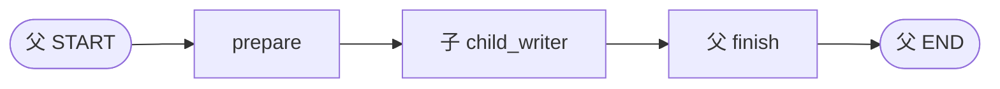
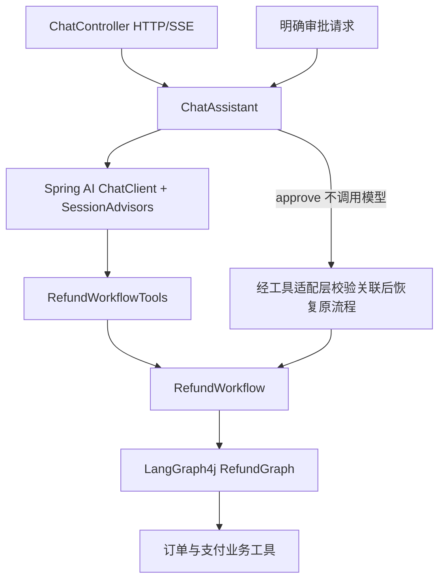
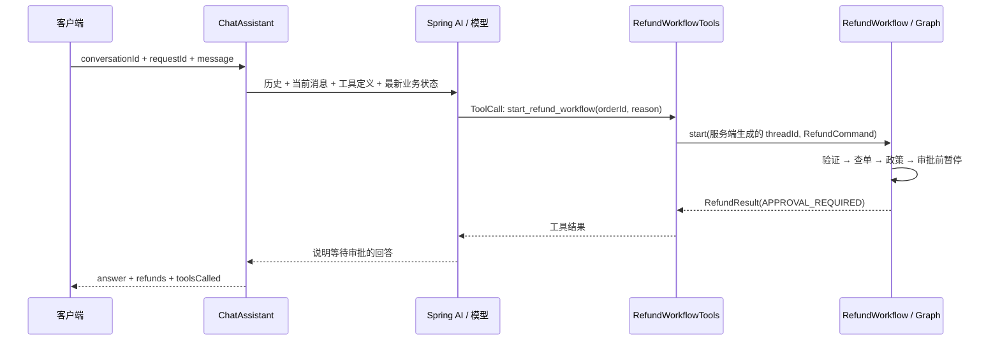
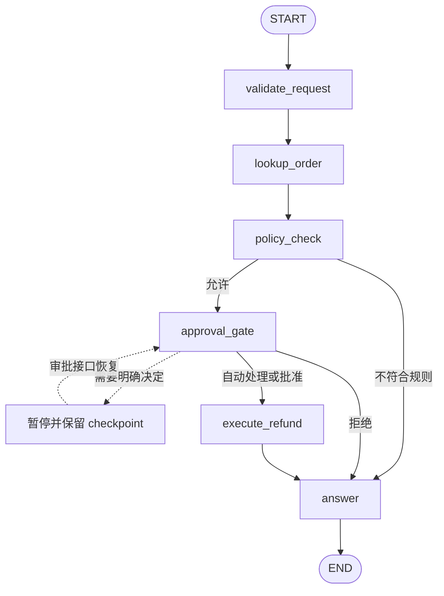

# 《spring ai 2 + LangGraph4j》系列教程（下）：流式、子图与完整退款助手

在[上篇](spring-ai-2-langgraph4j-01.md)中，我们已经建立 Spring AI 项目，理解 State、Node、Edge，并让流程具备 checkpoint、人工中断和恢复能力。

本篇从流式输出和子图开始，再把这些能力组合成一个可聊天、可追问、可调用退款工作流的助手。最后讨论验证方法、版本迁移和真实业务接入时的数据边界。

版本仍为 Java 25、Spring Boot 4.1.0、Spring AI **2.1.0-RC1**、LangGraph4j **1.9.7**。没有特别说明的代码块是源码摘录或学习片段；标为“设计伪代码”的部分需要自行实现其业务依赖。

第一次阅读时，建议依次运行 `streaming -Offline`、`subgraphs -Offline`，然后再启动 Web 服务体验退款。前两个实验不需要 key；HTTP 聊天使用真实模型配置，不能通过 CLI 的 `-Offline` 开关切换。上篇的 State、局部更新、追加 channel 和 resume 是本篇的前置知识。

本篇会反复区分三个结果：“用户看到了一个文字片段”“一个节点算完了”“一笔业务完成了”。它们发生在不同时间，只有分清来源，才能正确显示进度、审批按钮和最终金额。

## 第 7 讲：流式输出——文本、节点与业务事件

### 7.1 先区分三种“正在输出”

用户看到页面持续变化，背后可能有不同来源：

| 输出 | 例子 | 产生时机 |
| --- | --- | --- |
| 模型文本片段 | “这笔”“退款”“需要审批” | 模型生成过程中 |
| 图节点状态 | lookup_order 完成 | 节点执行边界 |
| 自定义业务事件 | 已处理 20/100 条、等待审批 | 业务代码主动上报 |

把完整回答逐字切开再发送，不是模型流式生成。节点完成后打印一次状态，也不是 token 流。教学时最好把来源明确标记，排查问题时才知道卡在模型、工具还是业务节点。

#### 7.1.1 stream 这个词出现了三次，含义并不相同

```text
模型服务的文本流
  → Spring AI Flux<ChatResponse>：收到模型响应片段
  → LangGraph4j AsyncGenerator：转发文本片段，同时输出图步骤
  → HTTP SSE：把应用选定的事件编码后发给客户端
```

三层可以独立存在。一个完全不调用模型的图也可以 stream 节点状态；一次非流式业务调用也可以通过 SSE 报告“正在查订单”；有了模型流，如果服务端先收集完整文本再发送，用户仍然看不到逐步生成。

因此排查“为什么没有流式效果”时，先确认哪一层真正产生事件、哪一层提前等待完整结果、哪一层只是网络或代理缓冲。不要只根据方法名里出现 `stream()` 就判断全链路实时。

### 7.2 Spring AI 原生文本流

学习片段：

```java
Flux<String> chunks = client.prompt()
        .user("讲一个关于猫的笑话。")
        .stream()
        .content();
```

如果需要消息角色、工具调用、usage 或结束信息，可以使用 `.stream().chatResponse()`。一个片段可能包含多个字符，也可能是控制信息；不要把 HTTP chunk 数量当作模型 tokenizer 的 token 数。

这里的 `Flux` 来自 Reactor，表示一系列随时间到达的值。创建请求描述与消费流是两个阶段。下面是消费文本流的学习片段，可放进已有 `client` 的实验代码中：

```java
client.prompt().user("讲一个关于猫的笑话。")
        .stream().content()
        .doOnNext(chunk -> System.out.print(chunk)) // 每到一段就显示
        .doOnError(error -> System.err.println("生成中断"))
        .blockLast(); // CLI 等待消费结束；不放在 WebFlux 事件循环中照搬
```

只拿到 `Flux` 而没有订阅或终端消费，不等于已经把结果发送给用户。本项目独立图实验由图执行器消费适配后的 generator；主应用由 `.collectList().block(...)` 等待结束，但在 `doOnNext` 中已经实时发出 token 事件，二者职责不同。

### 7.3 在图节点中接入 StreamingChatGenerator

独立示例先处理主题，再让写作节点使用真实模型流。核心源码摘录：

```java
UserMessage request = new UserMessage("写一个关于「" + state.topic() + "」的简短笑话。");
// 1. 保留响应流，不调用 block/collect 得到完整答案。
var responses = client.prompt().messages(request).stream().chatResponse();
var generator = StreamingChatGenerator.<LearningState>builder()
        // 2. 为流式输出标记来源节点，以及开始生成时的状态。
        .startingNode("stream_joke")
        .startingState(state)
        .mapResult(response -> {
            // 3. 流正常结束后接收聚合响应，返回一次完整的状态更新。
            var answer = response.getResult().getOutput();
            return Map.of(
                    LearningState.JOKE, answer.getText(),
                    LearningState.MESSAGES_STATE, List.<Message>of(request, answer),
                    LearningState.TRACE, List.of("stream_joke"));
        })
        .build(responses);
// 4. 把可消费的生成器交回图，框架随后转发片段并合并最终更新。
return Map.of(LearningState.JOKE, generator);
```

这里先把 generator 交给图执行器消费。流结束后，`mapResult` 才把完整正文和完整模型消息写回 State。最终 `joke` 是字符串；中间过程通过流事件观察。

不要在节点内提前 `.block()` 得到完整字符串，然后期待外层还能收到真正的生成片段。

#### 7.3.1 中间是 generator，最后为什么又是 String

普通节点通常返回 `{joke: "完整正文"}`。这里先返回 `{joke: generator}`，是使用框架对嵌入式生成器的处理能力：执行器发现 generator 后先消费它，向外暴露中间输出，再使用 `mapResult` 产生的 Map 更新真实状态。

因此不要在节点刚返回 Map 时就把其中的 joke 强转成字符串；也不要把 generator 当作要长期保存的业务对象。流正常完成后的状态才应包含完整 String 与完整 `AssistantMessage`。

| 时刻 | 外层观察到什么 | State 中应该如何理解正文 |
| --- | --- | --- |
| refine_topic 完成 | 普通节点输出 | 尚无最终笑话 |
| 模型正在生成 | 多个 StreamingOutput.chunk | 用于临时展示，不能当作已完成结果 |
| 模型正常结束 | mapResult 返回完整更新 | joke 保存完整正文，messages 追加本轮问答 |
| 图继续/结束 | 普通节点输出、最终状态 | 可以读取完整答案 |

这个映射只返回本次 `request/answer`。如果每个片段都追加一个 AssistantMessage，历史会被拆成许多不完整回答；如果流结束时再返回整份旧历史，又会重复追加。

### 7.4 消费图流

核心学习片段：

```java
var events = graph.stream(
        GraphInput.args(Map.of(LearningState.TOPIC, "冰淇淋")),
        RunnableConfig.empty());
for (var event : events) {
    if (event instanceof StreamingOutput<?> text) {
        // 先判别文本片段，再处理普通节点输出。
        System.out.print(text.chunk());
    } else {
        System.out.println("节点：" + event.node());
    }
}
```

具体 import、最终状态读取和片段收集见 [GraphExamples](../../src/main/java/com/example/refunddemo/examples/GraphExamples.java) 中的 streaming 分支。测试会检查所有片段拼接后的正文，与最终 State 和 AssistantMessage 一致。

运行：

```powershell
./scripts/run-graph-examples.ps1 -Example streaming -Topic '冰淇淋'
```

完整图源码：[StreamingExample](../../src/main/java/com/example/refunddemo/examples/StreamingExample.java)。

离线运行可观察事件结构：

```powershell
./scripts/run-graph-examples.ps1 -Example streaming -Offline -Topic '冰淇淋'
```

控制台中 `[node]` 是节点输出，直接打印的文字来自 `StreamingOutput`，`[accumulated answer]` 则从最终普通输出的状态读取。固定模型也会按测试协议产生片段，但它不证明外部提供方已连通；去掉 `-Offline` 才会调用配置的真实模型。

判断是否正确不能只看终端“动起来了”。应检查：所有文本片段按顺序拼接，是否与最终 State 的 joke 一致；最后一条模型消息是否也是完整正文；中途失败是否作为错误传播，而不是把半句话标成成功。现有 `GraphExamplesTest` 包含这些验证。

### 7.5 按观察目的选择输出方式

模型文本只是一类输出。排查流程、展示进度和保存诊断信息时，可以按下面的目的选择数据来源：

| 观察目的 | 想观察的内容 | 实现方式 |
| --- | --- | --- |
| 增量更新 | 本节点修改了哪些字段 | 节点 wrap hook 中观察 updates |
| 完整状态 | 当前已经累积了哪些结果 | 普通 NodeOutput 的 state |
| 模型文本 | 生成中的消息片段 | StreamingChatGenerator / StreamingOutput |
| 业务进度 | 自定义处理进度或等待信息 | Context 中的 Consumer<StepInfo> |
| 执行诊断 | 节点路径、配置、失败位置 | 节点 hook、日志、快照和追踪信息组合 |

LangGraph4j 的 `VALUES/SNAPSHOTS` StreamMode 用于选择状态输出形态；文本片段和自定义业务事件则通过上面相应的机制处理。给前端定义事件协议时，应明确每种事件的数据来源和完成语义。

这里对应的 import 是 `org.bsc.langgraph4j.spring.ai.generators.StreamingChatGenerator`。LangGraph4j 也有 LangChain4j 的流式适配器，名字相似，但接入的模型接口和泛型不同，不能仅凭类名复制 import。

`VALUES` 适合读取当前状态，`SNAPSHOTS` 在配置 saver 时适合观察 checkpoint 相关快照。不要照搬 Python 教程里的 `stream_mode="messages"`、`"custom"` 作为 Java 枚举；增量更新可从节点 wrap hook 的返回值观察，自定义业务事件使用应用 writer。

### 7.6 自定义 writer 放在哪里

退款图需要报告“正在查单”“等待审批”“退款完成”。项目定义 `StepInfo`：

```java
// 字段结构摘录，枚举和验证见真实源码
record StepInfo(String threadId, String step, Status status,
                Map<String, Object> data, boolean finish, Instant timestamp) {}
```

writer 作为本次调用的运行依赖放进 Context：

```java
record RefundContext(RefundToolExecutor tools, RefundPolicy policy,
                     Clock clock, Consumer<StepInfo> stepWriter) {}
```

图通过 `RunnableConfig` metadata 取得 Context。节点无需知道 HTTP、SSE、WebSocket 或控制台的细节；换一个 Consumer 就可以换一种观察方式。

`finish=true` 表示本次调用结束。等待审批也会结束本次调用，所以 finish 不等于“业务已经完成”。同样，节点的 success 事件也不单独证明支付已结算或 checkpoint 已成功落盘；客户端应以最终业务结果和状态查询为准。

源码：[RefundContext](../../src/main/java/com/example/refunddemo/refund/schema/RefundContext.java)、[StepInfo](../../src/main/java/com/example/refunddemo/refund/schema/StepInfo.java)、[RefundGraph](../../src/main/java/com/example/refunddemo/refund/graph/RefundGraph.java)。

### 7.7 图中的 writer 和模型的 token 如何在应用里汇合

主应用不把退款图的 `graph.stream()` 直接交给 HTTP。它有两条事件来源：

```text
ChatAssistant：ChatClient.stream().content().doOnNext(...)
    → token

RefundGraph：节点 wrap hook → RefundContext.stepWriter
    → workflow_step
RefundWorkflowTools：得到结构化 RefundResult
    → workflow_result / approval_required

两条来源 → AssistantEvent → ChatController 的 SseEmitter
```

所以“独立写作图怎样把模型流接入 Graph”和“聊天助手怎样在工具执行期间上报业务步骤”是两个组合方式。前者演示 `StreamingChatGenerator`，后者展示模型工具与业务图的事件汇合，源码阅读时要分清入口。

当用户只问候时，可能只有 token 和最终 result；当模型调用退款工具时，workflow 事件可能先出现，随后才有解释结果的文字。前端应按事件类型处理，不应硬编码“第一条必须是 token”。

### 7.8 中途出错、断线与最终结果

假设已经输出“这笔退款”，下一次模型响应失败，用户会看到一段不完整文本。正确处理是保留它作为未完成展示并提示失败；不能用流的结束或某一片段推断业务成功。

同样，用户关闭页面只是事件接收方消失，不能据此认定支付被取消。当前 demo 的 writer 在连接失败后停止发送，业务仍可能继续。需要取消长任务时，必须显式设计取消请求、可取消位置和已发生副作用的处理方式。

官方对照：[流式概念与 Spring AI 适配](https://github.com/langgraph4j/langgraph4j/blob/v1.9.7/src/site/mkdocs/core/streaming.md)、[Spring AI 流式 notebook](https://github.com/langgraph4j/langgraph4j/blob/v1.9.7/how-tos/llm-streaming-springai.ipynb)、[该版本生成器源码](https://github.com/langgraph4j/langgraph4j/blob/v1.9.7/spring-ai/spring-ai-core/src/main/java/org/bsc/langgraph4j/spring/ai/generators/StreamingChatGenerator.java)。

## 第 8 讲：子图——把能力拆成可以复用的模块

假设“写一段文本”会被笑话生成、营销内容和客服解释共同使用，可以将它封装为子图。子图本身也有节点、状态和边；父图把它视为一项能力。

### 8.1 方式一：直接把子图作为节点

父子图使用同一种 `LearningState`，共享 `topic/joke` 等字段：

```java
var child = LearningState.graph()
        .addNode("child_writer", writerAction)
        .addEdge(START, "child_writer")
        .addEdge("child_writer", END)
        .compile();

var parent = LearningState.graph()
        .addNode("prepare", prepareAction)
        .addNode("writing_subgraph", child)
        .addNode("finish", finishAction)
        .addEdge(START, "prepare")
        .addEdge("prepare", "writing_subgraph")
        .addEdge("writing_subgraph", "finish")
        .addEdge("finish", END)
        .compile();
```

上面的 action 变量代表已经定义的节点函数。完整源码会把父节点和子节点的消息、trace 都纳入状态合并，并在测试中检查执行顺序。

这种方式省去输入输出适配，但双方必须理解同一份状态字段及 reducer。字段同名而业务含义不同，会形成隐蔽耦合。

#### 8.1.1 从父节点到子节点，状态如何流动



子图内部也有自己的 START/END，但子图 END 只结束这项能力，父图会继续执行 finish。不要把子图结束理解成整张父图立刻结束。

假设输入 `topic=程序员`、`trace=[]`：

| 执行位置 | 返回更新重点 | 最终应观察到的内容 |
| --- | --- | --- |
| 父 prepare | trace 追加 prepare | 子图接收到已准备的父状态 |
| 子 child_writer | 写 joke，追加模型消息与 child_writer | 父图能读取子图的输出字段 |
| 父 finish | status=COMPLETED，追加 finish | trace 为 prepare、child_writer、finish |

这是共享 schema 的组合，不需要自己再把整个 child state 作为新增更新追加一次。父子图都有消息和 trace 的追加 channel，如果额外手工合并整份历史，就容易重复记录。现有测试用预先放入的消息检查它只保留一次。

### 8.2 方式二：在节点内调用子图，显式映射

父图使用 `topic/joke`；子图有自己的 `subject/text`。父节点负责翻译：

```java
.addNode("invoke_writer", (state, config) -> {
    // 输入只传子图需要的字段，父图的订单、审批、trace 等不需要一并传入。
    WriterState childResult = child.invoke(
            GraphInput.args(Map.of("subject", state.topic())),
            RunnableConfig.empty()).orElseThrow();
    // 输出只映射公开结果；text 不会以子图字段名泄漏到父状态。
    return CompletableFuture.completedFuture(Map.of(
            LearningState.JOKE, childResult.text(),
            LearningState.STATUS, "COMPLETED",
            LearningState.TRACE, List.of("invoke_writer")));
})
```

这样子图可以独立演进，父图只依赖输入输出契约。本示例不会把 `subject/text` 等子图私有字段复制回父状态。

映射关系可以直接画成：

```text
父输入 {topic: "程序员"}
    └─ 适配 → 子输入 {subject: "程序员"}
                   → private_writer
                   → 子结果 {subject: "程序员", text: "..."}
    ┌─ 适配 ← 只取 text
父更新 {joke: "...", status: "COMPLETED", trace: ["invoke_writer"]}
```

这里父图使用的类是 `LearningState`，子图使用 `WriterState`。不同 Java 类的 `value()` 即使都读取 Map，也不会自动完成 `topic → subject` 的重命名，这就是适配节点的价值。

#### 8.2.1 两种组合方式如何选择

| 比较项 | 直接嵌入 compiled child | 节点内显式 invoke |
| --- | --- | --- |
| 状态约定 | 父子共用字段语义和合并规则 | 父子可以有不同字段 |
| 输入输出转换 | 通常较少 | 适配节点明确转换 |
| 事件可见性 | 框架可暴露嵌套图输出 | 内部 stream 不会因为父图 stream 自动转发 |
| 父图视角 | 一项包含内部图结构的能力 | 一个普通节点调用另一项服务 |
| 适合场景 | 团队统一状态模型的可复用流程 | 独立演进、输入输出边界明确的模块 |

官方还支持将未编译的 `StateGraph` 直接加入父图。本项目选择两种最便于比较的实现，先掌握字段共享与显式映射，再阅读第三种方式的编译和配置传播。

### 8.3 子图的持久化、审批和流式边界

“能调用一个子图”不等于“自动得到完整的嵌套恢复能力”。尤其是第二种写法：

- 普通 `.invoke()` 会等待子图返回。子图内部 token 不会因为父图在 stream 就自动逐片转发。
- 若子图会暂停等待审批，父节点必须识别该状态，不能把它当成普通完成结果。
- 若子图有独立 saver，需要保存父子流程关联，并为子图分配稳定、隔离的 threadId。
- 父节点重试可能再次调用子图，需要判断是新建还是恢复原来的子流程。

本仓库的两个 Subgraph 示例聚焦状态组合，没有给它们添加持久化人工中断。需要扩展时，应明确父子图各自的 saver、流程标识和事件转发方式，并验收中断后加载到的快照与实际恢复位置。

源码：[SubgraphExample](../../src/main/java/com/example/refunddemo/examples/SubgraphExample.java)。运行：

```powershell
./scripts/run-graph-examples.ps1 -Example subgraphs -Topic '程序员'
```

### 8.4 跟着命令检查父子图边界

```powershell
./scripts/run-graph-examples.ps1 -Example subgraphs -Offline -Topic '程序员'
```

终端 `[shared child]` 对应直接嵌入的图输出，其中能观察到子图内部步骤；`[Mapped child]` 对应适配节点调用得到的父图最终结果。第二种父状态中应有 joke，没有 subject/text；父 trace 只有适配节点记录，不会自动复制子图私有路径。

可以做两个小实验：把子图 `subject` 改成 `writingSubject`，同时修改输入适配，确认父图仍使用 topic；在共享图输入中放一条已有消息，确认结束后该消息没有被追加两份。它们分别验证接口隔离和 reducer 合并。

若将有审批的子图放入适配节点，仅仅拿到 `Optional<State>` 并不证明子图已到 END。它可能只是暂停返回了中间状态。需要检查子流程业务状态与恢复位置，并保存 childThreadId，才能在下一次调用恢复原子流程。

官方对照：[子图概念与三种组合](https://github.com/langgraph4j/langgraph4j/blob/v1.9.7/src/site/mkdocs/core/subgraph.md)、[compiled graph 作为节点](https://github.com/langgraph4j/langgraph4j/blob/v1.9.7/how-tos/subgraph-as-compiledgraph.ipynb)、[node action 内调用子图](https://github.com/langgraph4j/langgraph4j/blob/v1.9.7/how-tos/subgraph-as-nodeaction.ipynb)。

## 第 9 讲：设计一个以 Spring AI 为入口的退款助手

### 9.1 先写清楚用户体验

我们希望助手能处理以下对话：

```text
用户：你好。
助手：正常打招呼，不启动任何退款流程。

用户：我想退款。
助手：请提供订单号和退款原因。

用户：O-2001，商品质量问题。
助手：调用退款工具，得到待审批状态，告知用户确认入口。

用户提交明确审批。
系统：恢复原来的图，执行退款，返回真实结果。

用户：刚才的退款怎么样了？
助手：查询该流程，解释真实进度。
```

普通聊天、政策咨询、申请退款和批准退款是不同操作。业务规则不能仅靠一句提示词约束。

### 9.2 分层结构



| 类/目录 | 负责什么 |
| --- | --- |
| ChatController | 请求校验、HTTP/SSE 输出 |
| ChatAssistant | 会话、请求去重、模型调用、响应组合 |
| RefundWorkflowTools | 暴露给模型的业务能力、会话与退款流程关联 |
| RefundWorkflow | start/approve/get 生命周期和同线程并发保护 |
| RefundGraph | 图拓扑、路由、统一节点事件 |
| refund/nodes | 独立业务节点 |
| refund/schema | State、Context、命令、结果和步骤 DTO |
| OrderRefundTools | 模拟订单与支付系统 |

这里有两层“工具”。外层 `start_refund_workflow/get_refund_status` 给模型使用；内层 `get_order/create_refund` 由图按业务规则调用。外层助手不会注册原始支付工具。

#### 9.2.1 顺着一次真实请求阅读，而不是一开始读完所有类

先跟踪“订单 O-2001，商品质量问题，请帮我办理退款”这条请求：



在 IDE 中按上图顺序跳转即可：`ChatController.chat → ChatAssistant.chat → RefundWorkflowTools.startRefund → RefundWorkflow.start → RefundGraph`。模型到 Java 工具的跳转由框架完成，所以不会在 ChatAssistant 中看到直接调用 `startRefund()` 的业务 if 分支。

有两份历史也不要混淆：外层聊天 Session 记录用户、助手和工具交互；图 State 中的 messages 记录图内部受控工具调用。主退款图不使用这些消息再做模型决策，普通业务节点直接读类型化命令与订单。

### 9.3 结构化命令进入图

输入 DTO：

```java
public record RefundCommand(String orderId, String reason) {}
```

实际 record 构造器检查订单号格式和原因长度。图的第一个节点再次验证命令边界，后面不用重新调用模型提取意图。

退款图：



规则是：已支付、签收不超过 30 天；金额大于等于 300 元或有风控标记则需要审批。执行退款前还要重新检查状态、金额、资格和审批。

模型不能通过工具参数把金额改成任意数字，也不能通过传入 `approved=true` 获得退款授权，因为这些参数根本不在外层模型工具的签名中。

#### 9.3.1 每个节点读取什么、写入什么

| 节点 | 主要读取 | 本节点新增或覆盖 | 是否有外部业务调用 |
| --- | --- | --- | --- |
| validate_request | command | 校验后的 command、运行状态 | 否 |
| lookup_order | command.orderId | order、工具消息 | 查询模拟订单 |
| policy_check | order、当前时间 | policy、status、等待说明 | 纯 Java 判断 |
| approval_gate | policy、approval | 无普通字段更新；可能在执行前暂停 | 否 |
| execute_refund | command、order、policy、approval | refund、工具消息 | 调用模拟退款 |
| answer | 策略、审批、凭证 | 最终 status、业务说明 | 否 |

trace 由统一节点 hook 追加，节点函数不用各自重复添加。审批接口跳过门节点动作时，则显式补充这一步的 trace。节点职责越明确，就越容易判断失败应该从哪里继续。

#### 9.3.2 把 O-2001 的状态展开

```text
输入：command={orderId: O-2001, reason: 商品质量问题}
  lookup_order 后：order 包含实付 399 元、签收时间、风控标记
  policy_check 后：eligible=true, needsApproval=true, status=APPROVAL_REQUIRED
  approval_gate 前：approval 缺失 → 暂停，refund 缺失
```

此时 `APPROVAL_REQUIRED` 是 policy_check 写入的业务状态；“下一节点为 approval_gate”是 checkpoint 的执行位置；“暂停”由门节点的中断检查触发。三个信息分别解决前端展示、恢复定位和执行控制，不能只设置一个状态字符串就认为框架自然停止。

换成 O-1001 时不需要人工决定，门节点放行；换成 O-3001 时政策不允许，条件边直接进入 answer，根本不经过执行退款节点。你可以先用这些固定订单练习画路由，再理解模型如何触发工具。

源码：[RefundCommand](../../src/main/java/com/example/refunddemo/refund/schema/RefundCommand.java)、[RefundPolicy](../../src/main/java/com/example/refunddemo/refund/RefundPolicy.java)、[ExecuteRefundNode](../../src/main/java/com/example/refunddemo/refund/nodes/ExecuteRefundNode.java)。

### 9.4 用原生 @Tool 包装工作流

真实工具签名摘录：

```java
@Tool(name = "start_refund_workflow",
      description = "用户明确要求退款且已提供订单号和原因时启动退款流程")
public RefundResult startRefund(String orderId, String reason, ToolContext context) {
    // 完整实现还校验用户提过该订单，并复用已有流程
    var runtime = AssistantToolContext.from(context);
    var command = new RefundCommand(orderId, reason);
    String threadId = "refund-" + UUID.randomUUID();
    return workflow.start(threadId, command,
            step -> runtime.emit("workflow_step", step));
}
```

这是解释调用关系的精简片段，不能直接替换真实方法。完整方法还做了：

1. 检查订单号确实由当前会话的用户提供，拒绝模型虚构订单号。
2. 一个会话中的同一订单复用原流程，避免模型重复调用时创建第二笔申请。
3. 在执行前登记关联；异常后只有明确查到“没有 checkpoint”才移除预约关联。状态查询失败时保留原关联，避免在结果不确定时再开新流程。
4. 返回 `RefundResult` 并发布业务事件。

`ToolContext` 由服务端通过 `.toolContext(...)` 注入。它不属于模型生成的业务参数；身份、权限和会话关联应该从这种可信上下文取得。

#### 9.4.1 模型参数、工具上下文与图上下文各是什么

| 位置 | 谁提供 | 放什么 | 本例 |
| --- | --- | --- | --- |
| 工具业务参数 | 模型根据用户消息提出 | 待校验的业务输入 | orderId、reason |
| Spring AI ToolContext | 应用在调用前注入 | 本轮会话关联、事件接收方等 | AssistantToolContext |
| LangGraph4j RunnableConfig metadata | 工作流服务构造 | 本次图执行依赖 | RefundContext |
| 图 State | 输入映射及各节点更新 | 可恢复的业务数据 | command、order、policy、approval |

这不是同一份 Map 在各层任意传递。`AssistantToolContext` 找到当前会话，外层工具据此定位流程；`RefundContext` 给图节点提供受控工具和规则服务。模型不负责构造它们。

例如外层工具签名只有 orderId、reason，图内执行器却能附加 `refundAuthorized=true`。这个标志由通过业务校验后的服务端路径注入，不能让模型在 JSON 参数里自行填写。即使设置了标志，mock 支付工具仍会验证参数和退款规则。

#### 9.4.2 为什么先登记关联，再运行图

假设图已经发起，但工具调用在响应阶段失败。如果直到所有步骤成功后才保存 `orderId → threadId`，下一次模型重试可能认为从未发起，于是新建第二个图。

真实实现先预约关联，再执行图。若发生异常，只在明确确认没有 checkpoint 时释放预约；若查询本身失败，就保留关联，等待查询或恢复。这处理的是“结果不确定”，不能用一个宽泛的 catch 把所有失败都当作从未开始。

已有流程的路径只查询原 thread，不再 start。因此同一会话重复谈到同一订单时，模型调用了工具也不必新建流程。若业务需要“拒绝后重新申请”，应另外设计申请编号，不能悄悄覆盖原关联。

源码：[RefundWorkflowTools](../../src/main/java/com/example/refunddemo/assistant/RefundWorkflowTools.java)。当前演示同一会话同一订单也不会在拒绝后自动创建新申请；真实系统如果支持重新申请，应增加明确的申请编号和业务规则。

### 9.5 让助手拥有会话和有限的工具循环

配置片段：

```java
var manager = DefaultToolCallingManager.builder()
        .observationRegistry(observations)
        .maxTotalToolCalls(4)
        .maxCallsPerTool(2)
        .toolExecutionExceptionProcessor(new DefaultToolExecutionExceptionProcessor(true))
        .build();

return ChatClient.builder(model, observations, null, null,
                ToolCallingAdvisor.builder().toolCallingManager(manager))
        .defaultAdvisors(SessionAdvisors.builder(sessions).build())
        .build();
```

这段代码定制 ChatClient 自动注册的工具 Advisor，没有再额外添加第二个工具循环。`true` 的异常处理配置让工具执行错误向应用传播，统一转换成错误响应，避免把未知执行结果交给模型随意描述。

`observations` 从 Spring 容器可选取得，没有监控注册表时使用 `ObservationRegistry.NOOP`。只为了创建 ChatClient，不必强制应用安装 Actuator。

完整配置：[AssistantConfig](../../src/main/java/com/example/refunddemo/config/AssistantConfig.java)。

这里两个次数限制也有不同含义：`maxTotalToolCalls(4)` 限制一轮中的总工具执行，`maxCallsPerTool(2)` 限制同名工具执行。它们保护模型工具循环，与图的 `recursionLimit`、业务幂等是三个独立层次。达到调用上限不表示退款已完成，仍应按异常和实际业务状态处理。

`SessionAdvisors` 负责聊天历史，不负责退款图的 checkpoint；工具管理器负责执行工具请求，不负责定义退款审批规则。把功能放在各自对应层，后面才能独立更换模型、存储或前端。

### 9.6 每轮对话实际发送什么

请求组装源码摘录：

```java
var spec = client.prompt()
        .system(prompt)
        .messages(new SystemMessage("以下为服务端查询的当前退款状态，金额、审批和是否完成以此为准："
                + json.writeValueAsString(tools.results(conversation))))
        .user(message)
        .tools(tools)
        .toolContext(Map.of(AssistantToolContext.KEY, runtime))
        .advisors(SessionAdvisors.session(conversationId));
```

为什么每轮附上当前状态？因为审批接口可能在模型对话之外完成退款。如果只依赖旧聊天记录，模型可能一直记得“等待审批”。新一轮通过业务状态查询补充最新事实，再允许模型调用状态工具核实。

结果分开保存自然语言与业务数据：

```java
public record ChatTurnResult(
        String conversationId,
        String requestId,
        String answer,
        List<RefundResult> refunds,
        List<String> toolsCalled) {}
```

前端显示金额、审批按钮和支付结果时，应使用 `refunds` 中的结构化字段。`answer` 用于解释；它不是新的业务事实来源。

提示词源码：[chat-assistant.txt](../../src/main/resources/prompts/chat-assistant.txt)。服务入口：[ChatAssistant](../../src/main/java/com/example/refunddemo/assistant/ChatAssistant.java)。

### 9.7 三种 ID 的一组具体例子

```text
conversationId = customer-chat-001
    ├─ requestId = turn-1：我要退款 → 追问，没有业务图
    ├─ requestId = turn-2：补全 O-2001 和原因
    │      └─ 服务端创建 threadId = refund-<UUID>
    ├─ requestId = approval-1：批准这个 threadId
    └─ requestId = turn-3：查询原 threadId
```

| ID | 谁生成 | 稳定范围 | 重试时怎么处理 |
| --- | --- | --- | --- |
| conversationId | 客户端提供或后端生成 | 这段聊天及其业务关联 | 延续对话必须沿用 |
| requestId | 客户端提供或后端生成 | 一次逻辑请求 | 同一操作重试沿用；新消息用新 ID |
| threadId | 外层退款工具生成 | 一笔退款图 | 查询、审批、恢复沿用 |

同一段对话可处理另一订单，关联另一个 thread。一个 thread 也能跨聊天请求继续。所以不能把 threadId 每轮随机生成，更不能拿用户传来的 requestId 当作审批授权。

若希望利用 HTTP 去重，客户端应主动生成并保存 requestId；每次都省略、让后端随机生成，就无法把重试识别成同一逻辑请求。conversationId 同理：如果每轮都省略，服务端会创建不同会话，历史就不会延续。

## 第 10 讲：人工审批与恢复要走明确的业务路径

### 10.1 审批不等待在工具调用栈上

图遇到人工审批时，本次调用返回 `APPROVAL_REQUIRED`。工具执行完毕，助手可以正常回复，HTTP 请求也可以结束。

之后审批请求携带 conversationId、threadId 和明确的 Boolean 决定。后端检查流程属于该会话，确认它仍停在 approval_gate，再保存决定并恢复。

```java
RunnableConfig updated = graph.updateState(config,
        Map.of(RefundState.APPROVAL,
                approved ? "APPROVED" : "DECLINED",
                RefundState.TRACE, List.of("approval_gate")),
        "approval_gate");
return execute(GraphInput.resume(), updated);
```

源码：[RefundWorkflow](../../src/main/java/com/example/refunddemo/refund/RefundWorkflow.java)。恢复后不重新解析自然语言，也不重新执行已经完成的前置节点；执行退款节点仍会复核当前业务条件。

#### 10.1.1 一次审批经过哪些检查

```text
HTTP approved 必须存在
  → 找到 conversationId 对应的会话
  → 检查 threadId 确实关联到该会话
  → 获得该流程的锁，读取最新 checkpoint
  → nextNodeId=approval_gate 且 status=APPROVAL_REQUIRED 且尚无决定
  → updateState 保存 APPROVED/DECLINED，并计算门节点的出边
  → resume 原图
```

这条路径不调用模型。HTTP 里的明确布尔值决定审批结果，模型不再判断“用户这句话算不算同意”，也不能把同意误转给另一个订单。

恢复时如果批准，继续到 execute_refund，再到 answer；如果拒绝，直接到 answer。`approval_gate.execute()` 是空操作，审批路径通过 `asNode="approval_gate"` 计算出边，所以不会重跑前面的订单查询和政策节点。

但执行退款仍需复核。时间可能已经过去，原来符合退款期限的订单可能不再符合。当前节点会根据已保存的订单数据和当前时钟重新计算资格；本地 mock 也有执行保护。接入真实订单系统时，还应刷新支付、订单和退款状态，不能把本示例的快照检查当作实时查询所有外部事实。

### 10.2 工具确认与业务审批不是同一个检查点

Spring AI 2.1 支持工具调用确认，用于“允许不允许执行这次工具调用”。而退款图内的审批，发生在已经查询订单、计算金额和判断政策之后。

| 检查点 | 回答的问题 | 保存的信息 |
| --- | --- | --- |
| Spring AI 工具确认 | 是否执行模型提出的这次工具请求 | 原始工具调用、参数、用户决定 |
| LangGraph4j 业务审批 | 已准备好的这笔退款是否继续 | 订单快照、金额、审批状态、恢复位置 |

本演示使用图内业务审批，没有另外叠加启动工具的确认。需要两层确认时可以增加，但应让用户知道每次确认的对象。

当前聊天文字“我同意”不会直接批准退款，也没有暴露 `approve_refund` 模型工具。这样可以把确认操作绑定到明确流程。生产系统仍需验证操作人身份、订单归属、审批角色和金额权限；会话隔离只是其中一部分。

版本依据：[Spring AI v2.1.0-RC1 工具确认文档](https://github.com/spring-projects/spring-ai/blob/v2.1.0-RC1/spring-ai-docs/src/main/antora/modules/ROOT/pages/api/tools/tool-call-confirmation.adoc)。

### 10.3 请求去重与支付幂等分开处理

助手层使用 `requestId` 处理客户端重试：

- 相同 requestId 和相同输入：返回上次成功结果。
- 相同 requestId 和不同输入：409 冲突。
- 同一会话并发请求：通过会话锁串行处理，避免历史和审批相互交错。

图层还检查线程的当前状态，拒绝已完成流程再次审批。模拟支付工具按订单保证不重复退款。

这些分别解决 HTTP 重试、模型重复调用和业务重复执行，不能相互替代。生产环境需要把去重结果持久化，并在数据库或支付服务中保证业务幂等；单个 JVM 的锁不提供跨实例互斥。

### 10.4 重复请求发生在哪一层，就检查哪一层

| 情况 | 防重复位置 | 预期行为 |
| --- | --- | --- |
| 网络超时后重发同一条聊天 | requestId + 输入缓存 | 返回上次成功响应，不重复调用模型 |
| 一轮内模型再次调用退款工具 | 会话中的 orderId → threadId 关联 | 查询原流程，不创建第二笔 |
| 两个审批请求竞争同一流程 | 流程锁 + 最新快照状态检查 | 一次继续，后到者不能重新审批 |
| 支付成功但节点失败后重做 | 支付端持久化幂等机制 | 复用已有业务结果 |

缓存只记录成功完成的请求。失败请求可能已经产生业务副作用，所以“没有请求缓存”不等于“退款没有发生”。此时优先查询原流程与支付结果，不能生成新业务键盲目重做。

还有一个容易误解的情况：重复 `turn-2` 会返回当时缓存的“待审批”响应，即使审批后来已完成。缓存是在回放那一次请求，查询最新状态则应发新的 requestId 或调用查询接口。两者面向不同问题。

### 10.5 为什么同时需要会话锁和流程锁

会话锁串行处理一段对话的消息和审批，防止历史与请求缓存交错；流程锁保护同一 thread 的读取、审批检查、状态更新和恢复。当前实现用固定数量的锁条带，避免为每个保留流程无限创建锁对象。

锁条带也可能让两个不同 thread 短暂共用同一把锁，它减少锁对象数量，代价是一定程度的额外串行。所有这些锁都只在当前 JVM 生效。多实例部署要以共享存储中的业务状态竞争控制和幂等为基础，不能只复制这些 `synchronized/ReentrantLock` 就认为问题已经解决。

## 第 11 讲：用 HTTP 和 SSE 跑通完整案例

### 11.1 启动应用

在项目根目录运行：

```powershell
$env:DEEPSEEK_API_KEY = '<你的 API key>'
mvn spring-boot:run
```

默认端口为 8080，可用 `SERVER_PORT` 覆盖。此项目提供 API，没有附带网页前端。

PowerShell 发送中文 JSON 时，显式按 UTF-8 编码。先定义一个便于复用的函数：

```powershell
function Send-Json($Path, $Payload) {
    $json = $Payload | ConvertTo-Json -Depth 10
    Invoke-RestMethod ("http://localhost:8080" + $Path) -Method Post `
        -ContentType 'application/json; charset=utf-8' `
        -Body ([Text.Encoding]::UTF8.GetBytes($json))
}
```

### 11.2 多轮追问后启动图

```powershell
$conversation = 'tutorial-' + [Guid]::NewGuid().ToString('N')
$first = Send-Json '/api/chat' @{
    conversationId = $conversation
    requestId = 'turn-1'
    message = '我想申请退款。'
}
$first.answer

$waiting = Send-Json '/api/chat' @{
    conversationId = $conversation
    requestId = 'turn-2'
    message = '订单 O-2001，商品质量问题，请帮我办理退款。'
}
$waiting | ConvertTo-Json -Depth 12
$thread = $waiting.refunds[0].threadId
```

第二个响应应包含 `start_refund_workflow` 工具调用记录，以及状态为 `APPROVAL_REQUIRED` 的退款结果。`threadId` 是后端生成的，后续直接使用返回值。

简化响应结构如下，金额等详细字段在 order/policy/refund 中：

```json
{
  "conversationId": "tutorial-example",
  "requestId": "turn-2",
  "answer": "这笔订单需要审批，目前尚未执行退款。",
  "refunds": [
    {
      "threadId": "refund-example",
      "status": "APPROVAL_REQUIRED",
      "approvalRequired": true,
      "refund": null
    }
  ],
  "toolsCalled": ["start_refund_workflow"]
}
```

自然语言内容由模型生成，不要求逐字相同。测试应断言真实状态和工具调用，而不是把整段文案写死。

先分别看下面几个字段，不要只看 answer：

| 字段 | 用来回答什么问题 | 待审批时的预期 |
| --- | --- | --- |
| toolsCalled | 模型实际请求执行过哪些工具 | 包含 start_refund_workflow |
| refunds[].status | 服务端判定的业务状态 | APPROVAL_REQUIRED |
| refunds[].approvalRequired | 是否需要显示明确审批入口 | true |
| refunds[].policy | 审批规则和金额是什么 | 按真实订单计算 |
| refunds[].refund | 是否已有执行结果和凭证 | null |
| refunds[].trace | 图实际走过哪些步骤 | 尚无 execute_refund |

读取 `refunds[0]` 是因为这组实验只处理一笔订单。真实界面有多个流程时，应按 threadId 或 command.orderId 找到目标，不能永远取第一项。

### 11.3 提交审批，再查询进度

```powershell
$approved = Send-Json "/api/chat/$conversation/refunds/$thread/approval" @{
    requestId = 'approval-1'
    approved = $true
}
$approved.refunds[0].status

$status = Send-Json '/api/chat' @{
    conversationId = $conversation
    requestId = 'turn-3'
    message = '请查询订单 O-2001 刚才那笔退款的当前进度。'
}
$status | ConvertTo-Json -Depth 12
```

重复提交相同 approval-1 应返回缓存结果；另一个 requestId 再次审批已完成流程会得到 409。省略 approved 不会默认同意，而是返回 400。

也可以直接查询结构化状态，避免通过模型解释再确认：

```powershell
$refunds = Invoke-RestMethod "http://localhost:8080/api/chat/$conversation/refunds"
$current = $refunds | Where-Object { $_.threadId -eq $thread }
$current | ConvertTo-Json -Depth 12
```

批准后重点检查 status、refund 金额与凭证、trace 中的 execute_refund。拒绝则检查没有 refund，且不会执行退款。接口返回 200 只能证明请求按接口语义处理完成，不能替代这些业务断言。

#### 11.3.1 按顺序做三次重复请求实验

在这一轮应用运行中继续：

1. 原样再提交 `approval-1` 和 `approved=true`，应回放同一成功响应。
2. 换成新的 requestId 再批准同一 thread，应得到 409，因为流程已不在等待审批。
3. 沿用 `approval-1`，却把 approved 改为 false，也应得到 409，因为同一请求标识已绑定不同输入。

这三次实验分别验证“网络重试去重”“业务状态保护”“请求键冲突”。如果重新启动服务，内存缓存和会话关联都会丢失，不能再用它验证上一进程的相同请求回放。

### 11.4 自动处理、拒绝与已退款

| 模拟订单 | 初始情况 | 预期处理 |
| --- | --- | --- |
| O-1001 | 99 元，签收 5 天 | 自动退款 |
| O-2001 | 399 元，签收 3 天，有风控标记 | 等待明确审批 |
| O-3001 | 签收 45 天 | 拒绝退款 |
| O-4001 | 已退款 | 不重复执行 |
| O-9999 | 不存在 | 返回拒绝结果 |

订单和支付是进程内 mock，多次实验会共享当前进程的退款账本。同一订单重复执行会复用已有凭证；需要重复体验首次退款时，重新启动应用。O-4001 则是预置的已退款订单。

### 11.5 接口清单

| 方法 | 地址 | 用途 |
| --- | --- | --- |
| POST | `/api/chat` | 普通聊天与业务工具调用 |
| POST | `/api/chat/stream` | 聊天文本与业务事件流 |
| GET | `/api/chat/{conversationId}/refunds` | 查询当前会话的退款结果 |
| POST | `/api/chat/{conversationId}/refunds/{threadId}/approval` | 明确审批并恢复 |
| POST | `/api/chat/{conversationId}/refunds/{threadId}/approval/stream` | 审批恢复事件流 |
| GET | `/api/refunds/graph` | 返回真实图的 Mermaid 定义 |

旧版直接启动退款的 `/api/refunds` 及旧审批地址已删除。新应用以聊天助手为入口，不能继续照搬旧版请求体 `query/threadId`。

### 11.6 SSE 事件的含义

`/api/chat/stream` 接受与 `/api/chat` 相同的 JSON 请求体。响应是 `text/event-stream`：

```text
event: token
data: "这笔退款"

event: workflow_step
data: {"threadId":"refund-example","step":"lookup_order","status":"running",...}

event: workflow_result
data: {"threadId":"refund-example","status":"APPROVAL_REQUIRED",...}

event: approval_required
data: {"threadId":"refund-example","status":"APPROVAL_REQUIRED",...}

event: result
data: {"conversationId":"tutorial-example","answer":"...","refunds":[...],"toolsCalled":[...]}
```

这是事件形状示意，省略号不是合法 JSON，实际顺序也取决于模型何时产生工具调用和文字。`result` 是本轮完整结果，`error` 表示流建立后的执行错误。

参数校验失败时可能直接返回 HTTP 400，尚未建立 SSE。前端应先检查响应状态和 Content-Type，再按 SSE 解析，不能把所有响应都当 token。

可以把请求保存为 UTF-8 的 `request.json`，然后使用：

```powershell
curl.exe -N http://localhost:8080/api/chat/stream -H 'Content-Type: application/json' --data-binary '@request.json'
```

浏览器原生 EventSource 不支持此处的 POST body，可用 `fetch` 读取响应流并按 SSE 协议解析。网络读取块不等于事件边界，解析器要能处理半条事件和多条事件合并到同一块的情况。

若客户端断线，已完成的支付不能被“发送事件失败”改写为支付失败。当前 writer 会隔离观察者异常；用户重连后通过状态查询获得权威结果。持久化事件补发和 Last-Event-ID 不在本 demo 的实现范围内。

### 11.7 SSE 的一条消息与一块网络数据并不相同

一条 SSE 消息由字段行组成，以空行分隔；`event:` 是类型，`data:` 是数据。此项目的 token 数据也是 JSON，所以原始流可能显示 `data: "这笔退款"`，解析 JSON 后才得到没有引号的字符串。

一次网络读取可能只读到半行，也可能同时读到多条事件。正确的消费过程是：增量解码 UTF-8 → 缓存未完成文本 → 按空行分割事件 → 读取 event/data → 按事件类型解析 payload。直接对每次 `reader.read()` 的字节块调用一次 `JSON.parse` 会在中文字符或事件被拆开时失败。

本项目事件的消费方式可以约定为：

| event 类型 | 典型消费方式 | 能否据此显示“已退款” |
| --- | --- | --- |
| token | 追加到本轮临时文本 | 否，模型可能仍在生成 |
| workflow_step | 更新步骤进度 | 否，单节点成功不是最终业务结果 |
| workflow_result | 更新对应 thread 的结构化业务状态 | 检查其 status 与 refund |
| approval_required | 显示绑定到该 thread 的审批操作 | 否，表示仍在等待 |
| result | 完成本轮响应，核对完整 answer/refunds | 以其中结构化状态为准 |
| error | 标记本轮失败，引导查询已有业务结果 | 否，错误也不自动撤销副作用 |

相同 requestId 的成功回放不重新执行模型和图，因此不保证再次产生原来的 token 与步骤序列；客户端仍可获得最终 result。此 demo 没有保存整段事件日志，不提供逐事件历史重播。

### 11.8 判断异常发生在哪一层

| 现象 | 优先检查 |
| --- | --- |
| 400，尚未返回 SSE | JSON 格式、message、approved、ID 校验 |
| 模型说信息不足 | 用户是否明确提供订单、原因和执行意图 |
| APPROVAL_REQUIRED | 正常的业务等待，检查是否确实尚无 refund |
| 404 查询不到流程 | conversation/thread 关联是否正确、是否重启过内存服务 |
| 409 | requestId 输入冲突或流程已经不在可审批状态 |
| 只有节点事件，之后长时间无文字 | 模型工具循环与后续生成、提供方流式支持 |
| 一次收到大量文本 | 客户端解析、服务端消费方式、反向代理缓冲 |

排查时记录 conversationId、requestId、threadId，才能把 HTTP、模型工具和图节点的记录串起来。单独一条“退款失败”的自然语言无法说明失败发生在哪里。

源码：[ChatController](../../src/main/java/com/example/refunddemo/web/ChatController.java)、[AssistantEvent](../../src/main/java/com/example/refunddemo/assistant/AssistantEvent.java)。

## 第 12 讲：State、Context、序列化与版本迁移

### 12.1 哪些字段应该保存

| 类型 | 例子 | 放置位置 |
| --- | --- | --- |
| 可恢复业务数据 | 命令、订单、策略、审批、凭证、trace | RefundState |
| 本次运行依赖 | 工具执行器、Clock、writer | RefundContext |
| 对外进度协议 | 节点名、状态、时间戳 | StepInfo |
| 对话关联 | 会话与流程映射、请求去重 | ConversationRegistry |
| 模型聊天记录 | 用户和助手消息、工具交互 | SessionService |

本项目通过 `RunnableConfig` metadata 传入运行依赖。恢复时重新注入 Context，避免把客户端、网络连接和回调函数序列化到 checkpoint。这样同一个业务快照可以在新建图实例、不同事件接收方的条件下继续执行。

源码：[RefundState](../../src/main/java/com/example/refunddemo/refund/schema/RefundState.java)、[ConversationRegistry](../../src/main/java/com/example/refunddemo/assistant/ConversationRegistry.java)。

### 12.2 Map<String,Object> 里的 record 为什么会变成 Map

JSON 只记录字段，不会天然记住任意 Java 对象的具体类型。如果 state 内部存放 Order、RefundCommand 等 record，反序列化后可能得到 LinkedHashMap，之后强转就会失败。

项目使用 `SpringAIJacksonStateSerializer` 处理 Spring AI 消息，并显式注册业务类型标识和序列化规则。业务 record 写入稳定的 `@type`，恢复时映射到允许的具体类型。

金额保留 `BigDecimal`，时间保留 `Instant` 精度。不要把金额统一变成 double，也不要为了避开序列化错误关闭 state clone；那样可能掩盖可变对象共享问题。

源码：[RefundStateSerializer](../../src/main/java/com/example/refunddemo/refund/graph/RefundStateSerializer.java)。测试：[RefundSerializationTest](../../src/test/java/com/example/refunddemo/RefundSerializationTest.java)。

如果以后修改 record 字段或状态枚举，需要给 checkpoint 数据做版本迁移，或者明确隔离旧流程。能够编译新代码，不代表能加载旧数据。

#### 12.2.1 一次序列化往返具体会丢失什么

内存里可能存放：

```java
Map<String, Object> state = Map.of(
        "command", new RefundCommand("O-2001", "商品质量问题"));
```

如果仅按普通 Map 保存为 JSON，内容大致是：

```json
{"command":{"orderId":"O-2001","reason":"商品质量问题"}}
```

再按 `Map<String,Object>` 读取，JSON 只告诉解析器 command 是一个对象，没有告诉它应该构造 `RefundCommand`。此时 getter 中的泛型不能把 LinkedHashMap 自动变成 record，后续调用会暴露类型错误。

本项目给允许恢复的 DTO 写入稳定的类型别名，并登记对应类型映射。模型消息交给 Spring AI 适配器，业务 record 交给明确登记的自定义规则，两者共同组成完整 serializer。

自定义 serializer 中还有两个 mapper：外层处理带类型信息的 State，`domainJson` 处理 record 的普通字段。如果自定义的 Order serializer 又调用注册了自己的同一个 mapper 来序列化 Order，就可能无限递归，因此这里特意分开。

#### 12.2.2 为什么没有写文件也可能遇到序列化异常

框架在执行中可能通过 serializer 克隆状态，隔离节点输出和可变对象。所以“我用的是 MemorySaver”不代表 serializer 永远不会用到。关闭 clone 可能让异常暂时消失，却会掩盖状态共享和类型丢失问题。

可靠的检查应做一次真正往返：状态里放入命令、订单、金额、时间和 Spring AI 消息 → 序列化 → 反序列化 → 继续调用 getter 和节点。只检查写出的 JSON 字符串非空，不足以证明恢复可用。

金额应保留 BigDecimal 的精度，时间应保留 Instant 所需精度；状态枚举以稳定名称保存。字段改名、枚举改名或类型别名变化都可能影响旧 checkpoint。升级框架版本时，先用旧数据做恢复实验，再决定迁移或隔离策略。

### 12.3 Spring AI 2.1 的几个实际迁移点

- 使用本文版本的 Session API 配置会话，不混用多套消息记忆。
- 工具循环由 ChatClient 的 Advisor 管理；配置时避免再添加一套重复循环。
- 自定义或测试 `ChatModel` 时，本文版本读取 `getOptions()`。只覆盖旧的 `getDefaultOptions()` 可能使工具选项没有进入实际请求。
- Jackson 2 与 Jackson 3 的同名类包不同，依赖和 import 需要逐处确认。
- 模型提供方要支持原生工具调用与流式工具调用，不能只用一次普通问答成功判断完整兼容。

本项目离线 HTTP 测试使用真实 Spring AI ChatClient、SessionAdvisors 和工具执行框架，只替换模型返回。它会生成真正的 ToolCall，由框架执行工具，而非在假模型中直接调用退款方法。

源码：[AssistantHttpTest](../../src/test/java/com/example/refunddemo/web/AssistantHttpTest.java)。

### 12.4 只换 saver，为什么整个聊天服务仍不能重启恢复

假设把退款图换成磁盘 saver，但其他部分保持不变。重启后即使 thread 的 checkpoint 还在，也会遇到：

```text
图状态在磁盘：refund-001 仍然存在
会话关联在内存：conversation-001 不再知道自己关联 refund-001
聊天历史在内存：模型不知道用户先前说过什么
成功请求缓存在内存：重复 requestId 无法回放原响应
模拟支付账本在内存：不具备真实渠道的持久化执行记录
```

完整恢复需要同时设计这些存储和关联，不是只给 `CompileConfig` 换一个 saver。上篇的文件示例证明的是独立业务图能够跨进程继续，本项目主服务的默认装配仍以演示为目标。

官方 Session 文档给出 JDBC repository 扩展方向，但给聊天历史接 JDBC 也不会自动持久化本项目的会话到退款 thread 的业务映射。各份数据必须有明确的存储归属。

## 第 13 讲：如何验证自己真的实现了助手 + 图

### 13.1 三层测试分别证明什么

| 验证层次 | 证明内容 | 不能据此推断 |
| --- | --- | --- |
| 策略、图、序列化单元测试 | 分支、恢复位置、类型、幂等和异常行为 | 真实模型能正确选工具 |
| 固定模型 + 真实 HTTP/SSE | 应用装配、工具循环、请求和事件契约 | 外部模型服务可用 |
| 真实提供方集成测试 | 模型记忆、追问、工具选择、真实文本流 | 真实支付渠道已经接通 |

默认执行：

```powershell
mvn clean verify
./scripts/run-graph-examples.ps1 -Example all -Offline
```

真实模型执行：

```powershell
$env:DEEPSEEK_API_KEY = '<你的 API key>'
mvn -Plive-graph verify
```

`live-graph` profile 运行 `*LiveIT`，包括五个图示例和聊天助手 HTTP 契约。测试不能只断言 200；还检查工具名、状态、金额、审批前是否无副作用、片段是否真实产生等。

#### 13.1.1 推荐的新手验证顺序

先排除外部模型的不确定性，再验证真实提供方：

```powershell
# 1. 按项目实际 Java 版本编译，并清理旧 class，避免删掉的测试仍从 target 被执行。
mvn clean verify

# 2. 观察五项 Graph 能力；不需要 key，仍会真实执行图和存储代码。
./scripts/run-graph-examples.ps1 -Example all -Offline

# 3. 单独做上篇的 durable-start / durable-resume，确认两个进程能继续同一草稿。

# 4. 配置 key 后再执行真实提供方集成测试。
$env:DEEPSEEK_API_KEY = '<你的 API key>'
mvn -Plive-graph verify
```

如果第一步失败，先按具体测试定位图路由、类型或应用装配；如果只有第四步失败，再看提供方连通性、工具调用兼容性和模型行为。不要用真实模型返回的随机文本去调试一个本来就能离线复现的 reducer 错误。

`GraphExamplesTest` 用固定响应让第一次笑话过长，明确触发第二次写作；真实模型不保证刚好走两次，所以真实测试更侧重最终结果与流的一致性。固定模型是为了控制输入条件，测试仍应通过真实 ChatClient/Graph 路径执行。

#### 13.1.2 按你刚读的章节寻找现有测试

| 学习主题 | 看什么断言 | 测试位置 |
| --- | --- | --- |
| 状态合并、重写 | attempts、重复 trace、消息条数 | GraphExamplesTest |
| 时间旅行 | 原 thread 保留、新 thread 修改主题 | GraphExamplesTest |
| 中断和磁盘恢复 | 新 saver/图实例恢复，草稿不重新生成 | GraphExamplesTest |
| 副作用后失败 | 重试后只有同一份发布、收据一致 | GraphExamplesTest |
| 图流 | 拼接片段等于最终消息，中途异常传播 | GraphExamplesTest |
| 类型恢复 | record、消息、金额和时间仍可读取 | RefundSerializationTest |
| 并发审批 | 一笔流程不能同时被批准两次 | RefundWorkflowTest |
| HTTP 工具循环 | 模型返回 ToolCall，框架实际执行工具 | AssistantHttpTest |

学习时不必一开始研究整个测试框架。先找到和刚才实验对应的断言，反过来看测试如何制造“需要重写”“等待审批”“发布后报错”等条件，会比只看一条成功日志更容易理解恢复机制。

### 13.2 值得保留的验收场景

1. 问候、政策咨询不触发退款。
2. 只说“我要退款”会追问；补齐订单和原因后才启动图。
3. 同一会话记得代号；其他会话看不到这段历史。
4. 待审批时没有退款凭证；聊天“同意”不能绕过明确审批。
5. 其他会话不能审批当前流程；缺失 approved 得到 400。
6. 相同请求重试返回同一结果；冲突输入返回 409。
7. 自动退款、拒绝退款、审批拒绝和审批通过各走正确分支。
8. SSE 同时包含模型文本和图步骤；断线观察者不会改变业务结果。
9. 服务端启动失败不永久污染会话；存在或无法确认的流程不被重复创建。
10. 磁盘 saver 在新图实例中恢复；成功副作用遇到后续异常时不会重复执行。

完整契约：[AssistantHttpContract](../../src/test/java/com/example/refunddemo/web/AssistantHttpContract.java)、[RefundWorkflowTest](../../src/test/java/com/example/refunddemo/RefundWorkflowTest.java)、[RefundWorkflowToolsTest](../../src/test/java/com/example/refunddemo/assistant/RefundWorkflowToolsTest.java)。最新实测次数与环境见[验证记录](../graph-examples-verification.md)。

### 13.3 从演示到实际业务，还要补哪些部件

当前项目默认会话、流程关联、去重缓存、退款 saver 和支付 mock 都在内存中。文件恢复示例证明了 checkpoint 恢复方式，不等于整个聊天服务已支持重启恢复。

实际接入可以按下面顺序推进：

| 部件 | 需要落地的内容 |
| --- | --- |
| 身份和授权 | 登录用户、租户、订单归属、审批权限 |
| 业务关联 | 持久化 conversationId、申请编号、threadId 的对应关系 |
| 状态存储 | 会话 repository、checkpoint 存储、数据版本迁移 |
| 支付一致性 | 持久化幂等键、真实结果查询、对账与异常补偿 |
| 并发 | 多实例锁或数据库状态竞争控制 |
| 生命周期 | 会话 TTL、去重保留期、流程归档、数据清理 |
| 可观测性 | 请求与流程关联日志、失败告警、模型和工具耗时 |

对耗时很长的流程，工具应提交任务并返回流程 ID，后台执行器负责继续运行；助手用状态查询工具查询进度。不要把几小时的业务任务一直挂在一次模型工具调用上。

模型成功生成“已退款”也不代表退款成功。支付凭证、业务状态和授权规则始终由服务端记录决定。

## 第 14 讲：能力与源码索引

完成前面的实验后，可以用这张表回查每项能力的实现位置和关键约束：

| 能力 | 实现位置或方式 | 关键约束 |
| --- | --- | --- |
| Graph API：State/Node/Edge | LearningState、GraphApiExample | 节点返回部分 Map 更新 |
| Reducer / MessagesState | Channels、MessagesState<Message> | 列表追加是否去重需要显式选择 |
| 输入/输出/私有 schema | RefundCommand/RefundState/RefundResult | 使用 DTO 显式映射 |
| 入口与出口 | START/END 的边与条件路由 | 所有分支都应有明确终止或等待条件 |
| 动态任务分发 | 应用级并发任务或独立子图 | 限制并发，并为单项恢复保存稳定任务标识 |
| Command | Command(gotoNode, update) | 同时给出路由选择与状态更新 |
| Config / recursion limit | RunnableConfig / CompileConfig | 运行依赖与编译设置分开 |
| 图可视化 | GraphRepresentation.MERMAID | 输出图定义，可交给 Markdown 渲染 |
| Thread / checkpointer | MemorySaver、FileSystemSaver | 内存 saver 不跨进程 |
| 状态/历史/选中快照 | stateOf/getState/getStateHistory | 查询实际 nextNodeId |
| Time Travel / update | 复制快照到新 thread，再 updateState | 避免覆盖原 checkpoint 槽位 |
| 长期记忆 | 应用持久化 Repository | 不等同于聊天历史或 checkpoint |
| 持续运行 | 独立节点、checkpoint、幂等操作 | 明确失败后重做与复用的边界 |
| 可靠持久化 | saver 和应用存储策略 | 核实写入原子性、并发与故障窗口 |
| interrupt / resume | InterruptibleAction + updateState + GraphInput.resume | 同一流程恢复，不重新 start |
| 异常恢复 | 校验 nextNodeId 后恢复，副作用端去重 | checkpoint 不提供支付 exactly-once |
| 状态与文本流 | hook、NodeOutput、StreamingOutput | 区分增量、完整状态和模型片段 |
| 自定义进度与诊断 | StepInfo writer、hook、日志 | 前端事件与持久化成功分开判断 |
| 子图作为节点 | addNode(name, compiledChild) | 关注共享字段和 reducer |
| 节点内调用子图 | 输入输出映射、child.invoke | 流转发和恢复关联需要显式设计 |

## 源码阅读顺序与参考资料

如果想看详细实现，建议按这个顺序阅读：

1. [LearningState](../../src/main/java/com/example/refunddemo/examples/LearningState.java) 和五个 [examples](../../src/main/java/com/example/refunddemo/examples/)：先掌握框架概念。
2. [ChatController](../../src/main/java/com/example/refunddemo/web/ChatController.java)：了解外部 API 和事件入口。
3. [ChatAssistant](../../src/main/java/com/example/refunddemo/assistant/ChatAssistant.java)：理解会话、请求去重和模型调用。
4. [RefundWorkflowTools](../../src/main/java/com/example/refunddemo/assistant/RefundWorkflowTools.java)：理解模型工具如何封装业务图。
5. [RefundWorkflow](../../src/main/java/com/example/refunddemo/refund/RefundWorkflow.java) 与 [RefundGraph](../../src/main/java/com/example/refunddemo/refund/graph/RefundGraph.java)：查看启动、中断、恢复和节点路由。
6. [nodes](../../src/main/java/com/example/refunddemo/refund/nodes/) 与 [schema](../../src/main/java/com/example/refunddemo/refund/schema/)：查看可测试的业务节点和状态模型。
7. [测试目录](../../src/test/java/com/example/refunddemo/)：阅读成功、失败、重试和隔离的实际断言。

上游源码与文档：

- [Spring AI v2.1.0-RC1](https://github.com/spring-projects/spring-ai/tree/v2.1.0-RC1)：本文版本依据。
- [Spring AI Session 文档源码](https://github.com/spring-projects/spring-ai/blob/v2.1.0-RC1/spring-ai-docs/src/main/antora/modules/ROOT/pages/api/session.adoc)。
- [Spring AI Tool Calling 文档源码](https://github.com/spring-projects/spring-ai/blob/v2.1.0-RC1/spring-ai-docs/src/main/antora/modules/ROOT/pages/api/tools.adoc)。
- [LangGraph4j v1.9.7](https://github.com/langgraph4j/langgraph4j/tree/v1.9.7)：查看核心、how-tos 和 Spring AI 适配器。
- [LangGraph4j Core 概念](https://github.com/langgraph4j/langgraph4j/blob/v1.9.7/src/site/mkdocs/core/core-library.md)：State、Channel、配置与 checkpoint；具体默认值核对同 tag 源码。
- [LangGraph4j Spring AI 流式示例](https://github.com/langgraph4j/langgraph4j/blob/v1.9.7/how-tos/llm-streaming-springai.ipynb)：对照第 7 讲的 generator 与 mapResult。
- [LangGraph4j compiled 子图示例](https://github.com/langgraph4j/langgraph4j/blob/v1.9.7/how-tos/subgraph-as-compiledgraph.ipynb)、[映射子图示例](https://github.com/langgraph4j/langgraph4j/blob/v1.9.7/how-tos/subgraph-as-nodeaction.ipynb)：对照第 8 讲。
- [本仓库参考源码说明](../../ref-source/README.md)：如何克隆对应 tag 到 ref-source，包含当前参考提交。

最后可以尝试新增一个“修改收货地址”工具：外层仍由助手追问，图负责查单、判断是否已发货、校验新地址并执行更新。你会发现，复用的是会话入口、业务工具契约、状态图和事件协议；每种业务自己的规则仍然清楚地保留在对应流程中。
