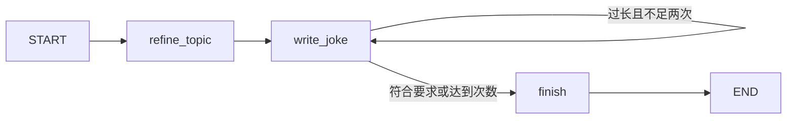
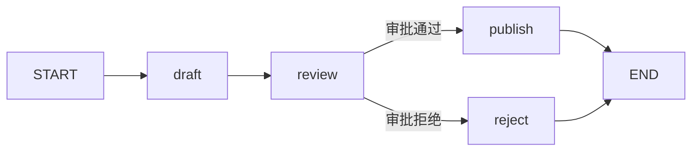

# Java Graph 五节示例：LangGraph4j + Spring AI

本组示例依次讲解 Graph API、持久化、持续运行、流式输出和子图。
每个示例都可以独立运行；详细原理见[系列上篇](blog/spring-ai-2-langgraph4j-01.md)和[系列下篇](blog/spring-ai-2-langgraph4j-02.md)。
使用 Java 25、Spring Boot 4.1.0、Spring AI **2.1.0-RC1** 和 LangGraph4j **1.9.7**。

每个示例都接入 Spring AI `ChatClient`；默认调用真实模型，显式加 `-Offline` 才使用固定文本。
示例是独立 Java CLI，不加载 Spring Boot 上下文，也不依赖外部数据库。
在现有 Spring 应用中，也可以把注入的 `ChatClient` 传给同样的 `build/create` 方法。

## 章节和源码

| 学习内容 | Java 示例源码（`src/main/java/com/example/refunddemo/examples/`） | 观察重点 |
| --- | --- | --- |
| 准备：命令入口与状态 | `GraphExamples.java`、`LearningState.java` | 命令入口、状态和依赖准备 |
| 示例一：Graph API | `GraphApiExample.java` | 模型节点、局部更新、列表 reducer、条件边、限制次数的重写循环、Mermaid |
| 示例二：持久化 | `PersistenceExample.java` | thread 隔离、历史快照、checkpoint 选择、修改主题并从该步重放 |
| 示例三：持续运行 | `DurableExecutionExample.java` | 磁盘保存、动态人工中断、跨进程审批恢复、异常后重试、幂等副作用 |
| 示例四：流式输出 | `StreamingExample.java` | 节点状态事件、Spring AI 真正的流式文本片段、最终完整消息 |
| 示例五：子图 | `SubgraphExample.java` | 同一状态直接嵌入、不同状态显式转换两种方式 |

## 先跑起来

在项目根目录使用 PowerShell：

```powershell
$env:JAVA_HOME = 'C:\tools\jdk-25' # 按实际 JDK 安装位置修改
$env:Path = "$env:JAVA_HOME\bin;$env:Path"
$mvn = 'mvn.cmd' # Maven 已加入 PATH；也可以填写 mvn.cmd 的完整路径

# 无需 API Key，先观察全部图的执行行为
./scripts/run-graph-examples.ps1 -Example all -Offline -Maven $mvn
```

脚本编译源码并生成运行 classpath，接着启动 `GraphExamples.main`。
后续只改变参数、未修改代码时可加 `-SkipBuild`。
`all` 默认生成一个新的持久化 threadId，可重复运行；需要单独恢复时指定 `-Thread`。
`OFFLINE` 输出明确标记固定文本，不能用来证明模型连通性。

真实 API 配置通过环境变量设置，密钥不写进项目：

```powershell
$env:DEEPSEEK_API_KEY = '<在当前终端填入真实 key>'
$env:DEEPSEEK_BASE_URL = 'https://ark.cn-beijing.volces.com/api/v3'
$env:DEEPSEEK_MODEL = 'deepseek-v4-flash-ga-260731'
./scripts/run-graph-examples.ps1 -Example all -Maven $mvn
```

上述地址通过 Spring AI `DeepSeekChatModel` 访问兼容的 `/chat/completions`。
独立 CLI 的普通请求与 SSE 共用 JDK HTTP 客户端及系统 DNS，连接超时 30 秒，普通请求读取超时 2 分钟。
这些示例是短文本生成任务，模型选项关闭 thinking 并限制最多 1024 输出 token。
省略地址时默认 `https://ark.cn-beijing.volces.com/api/v3`，省略模型时默认 `deepseek-v4-flash-ga-260731`，与 Spring Boot 的 YAML 默认配置一致。
Spring Boot 服务也支持这三个环境变量。

## 示例一：Graph API



```powershell
./scripts/run-graph-examples.ps1 -Example graph-api -Topic '程序员与猫' -Maven $mvn
```

`refine_topic` 用 ChatClient 细化主题；`write_joke` 根据主题生成笑话。
Java 条件边检查长度，最多生成两次；超限后返回 `LIMIT_REACHED`，不会无限循环。
节点返回 `Map.of(...)` 局部更新；未返回的主题、消息等字段继续保留。
调用入口还会输出由真实图生成的 Mermaid 定义。

`LearningState` 中普通字段覆盖，`messages/trace` 使用 `Channels.appenderWithDuplicate(ArrayList::new)` 累加。
连续两次 `write_joke` 必须在 trace 中保留两次，才能准确表示实际执行历史。
`Channels.appender(...)` 默认去重，适用于需要唯一元素的字段。
累加 channel 的节点只返回本次新增项，返回完整历史会产生重复。

示例中的 `UserMessage/AssistantMessage` 是 Spring AI 消息；第二次写作会把前次消息交回真实 ChatClient。
序列化使用 `SpringAIJacksonStateSerializer`，不需要为学习示例关闭 state clone。

## 示例二：持久化、历史和时间旅行

```powershell
./scripts/run-graph-examples.ps1 -Example persistence -Maven $mvn
```

流程为 `START -> generate_topic -> write_joke -> END`。
编译时设置 `MemorySaver` 和 `releaseThread(false)`，使执行结束后仍可查看 checkpoint。
如果沿用默认的 `releaseThread(true)`，结束时会释放活动线程，不能按示例直接查看活动历史。

命令依次执行：

1. 用一个 threadId 生成主题和笑话。
2. 通过 `getStateHistory` 打印各步 checkpointId、node、nextNodeId 和 createdAt。
3. 选择 `generate_topic` 之后、`write_joke` 之前的 checkpoint。
4. 把选中快照复制到新 thread，主题改为“小鸟”，从 `write_joke` 重放。
5. 原 thread 的主题、笑话和历史保留。

LangGraph4j 1.9.7 的 `updateState` 会替换所选 checkpoint 槽位。
因此 `replayWithTopic` 显式通过 saver 把快照复制到新 thread，再修改和恢复，避免覆盖原历史。
`updateState(..., "generate_topic")` 的第三个参数代表视为该节点完成，下一步才是 `write_joke`，不会重新生成主题。

`MemorySaver` 只保存当前进程内的数据；下一节使用磁盘 saver 验证进程间恢复。

## 示例三：持续运行、人工审批和失败恢复



`draft` 调用 Spring AI 生成笑话，保存模型消息和正文。
`review` 实现 `InterruptibleAction`，缺少人工决定时暂停在执行之前；不会发布内容。
`FileSystemSaver` 把状态保存到 `.graph-checkpoints`，包括 Spring AI 消息。
`publish` 是本地发布 mock，写入 `publications/<threadId>.txt`；不发送外部消息。

先生成草稿，命令执行后 Java 进程退出：

```powershell
./scripts/run-graph-examples.ps1 -Example durable-start -Thread joke-001 -Topic '不想上班的猫' -Maven $mvn
```

重新启动另一个 Java 进程，使用相同目录和 threadId 审批：

```powershell
./scripts/run-graph-examples.ps1 -Example durable-resume -Thread joke-001 -Approved true -SkipBuild
```

可用 `-Approved false` 验证拒绝分支，拒绝不会调用发布器。
新建草稿必须用新的 threadId；重复审批已完成流程会报错，避免再次执行副作用。
审批值必须明确传入 `true/false`。

演示发布阶段失败，再恢复同一流程：

```powershell
./scripts/run-graph-examples.ps1 -Example durable-start -Thread joke-retry-001 -Maven $mvn
./scripts/run-graph-examples.ps1 -Example durable-resume -Thread joke-retry-001 -Approved true -FailPublish -SkipBuild
# 上一条预期失败；随后重试，保留已生成草稿和已记录审批
./scripts/run-graph-examples.ps1 -Example durable-retry -Thread joke-retry-001 -SkipBuild
```

恢复使用 `GraphInput.resume()`，普通输入使用 `GraphInput.args(...)`，新运行无输入使用 `GraphInput.noArgs()`。
审批先通过 `updateState(..., "review")` 记录决定并选定下一节点，再恢复。
重试只允许“已审批且下一节点是 publish”的线程，不会重写草稿或重新审批。

文件发布器以 threadId 为幂等键：同一键与同一正文返回已有收据，不重复创建文件；正文不同则报冲突。
测试也覆盖“副作用成功但节点随后失败”的重试场景。
这演示了应用端幂等，不能把 checkpoint 理解为外部操作自动 exactly-once。
`FileSystemSaver` 用于本地教学，不提供多进程并发写入或文件写入中断时的事务保证。

示例采用独立节点、saver、明确的状态更新和 resume，并在副作用端实现幂等。
一个节点内的多次外部调用可能随节点一起重跑，必要时继续拆分节点或持久化各项操作结果。

## 示例四：流式输出

```powershell
./scripts/run-graph-examples.ps1 -Example streaming -Topic '冰淇淋' -Maven $mvn
```

先输出 `refine_topic` 的状态，再逐片输出模型文本，最后输出完整答案。
链路是：

```text
ChatClient.prompt().stream().chatResponse()
  -> Flux<ChatResponse>
  -> StreamingChatGenerator<LearningState>
  -> graph.stream(GraphInput.args(...), RunnableConfig.empty())
  -> StreamingOutput.chunk() 与普通 NodeOutput
```

没有把 `.call().content()` 得到的完整回答再人为拆字。
片段由提供方流式接口产生，可能包含多个字符，不能把每个片段都当成一个 tokenizer token。
`mapResult` 在流结束时把完整正文、完整 AssistantMessage 和本次 trace 一次写回 state。
测试检查片段拼接与最终消息完全一致，也检查中途断流会传播错误。

本例用普通 `NodeOutput` 观察状态，用 `StreamingOutput` 观察文本片段。
LangGraph4j 有 `VALUES/SNAPSHOTS` 两种 `StreamMode`；自定义业务事件通过 Context 中的 writer 发出。

## 示例五：两种子图组合

```powershell
./scripts/run-graph-examples.ps1 -Example subgraphs -Topic '程序员' -Maven $mvn
```

`sharedState` 的父子图共用 `LearningState`，通过 `.addNode("writing_subgraph", child)` 直接嵌入。
父图准备状态，子图调用 Spring AI 写作，父图接着结束；输出中能看到子图内部节点。
测试验证已有消息、子图消息及 trace 都只合并一次。

`mappedState` 的父图用 `topic/joke`，子图用私有的 `subject/text`。
父节点把 `topic -> subject` 后调用子图，再把 `text -> joke` 写回父图。
子图字段不会泄露到父 state；显式 `.invoke()` 的内部子图输出不会自动作为父流事件转发。
这种在节点内显式调用子图的方式，适合父子图采用不同业务状态的情况。

## 测试与版本验证

```powershell
# 默认离线回归：包括退款、HTTP/SSE 与独立 Graph 测试
& $mvn test

# 显式启用真实模型集成测试；须先设置三个 DEEPSEEK_* 环境变量
& $mvn -Plive-graph verify
```

默认回归替换的只是外部模型提供方，实际执行 ChatClient、Graph、消息序列化、磁盘读写及恢复。
`GraphExamplesLiveIT` 由 `live-graph` profile 单独执行，分别验证五节，子图验证两种方式。
真实测试检查非空模型回答、历史分支保留、磁盘恢复、真实流片段与完整回答一致。
结果记录见 [Graph 示例验证记录](graph-examples-verification.md)。

## 上游依据

- [LangGraph4j 1.9.7 发布说明](https://github.com/langgraph4j/langgraph4j/releases/tag/v1.9.7)
- [Spring AI 2.1.0-RC1 发布说明](https://github.com/spring-projects/spring-ai/releases/tag/v2.1.0-RC1)
- [StateGraph 与执行器源码](https://github.com/langgraph4j/langgraph4j/tree/v1.9.7/langgraph4j-core/src/main/java/org/bsc/langgraph4j)
- [checkpoint 与 saver 源码](https://github.com/langgraph4j/langgraph4j/tree/v1.9.7/langgraph4j-core/src/main/java/org/bsc/langgraph4j/checkpoint)
- [Spring AI StreamingChatGenerator 源码](https://github.com/langgraph4j/langgraph4j/blob/v1.9.7/spring-ai/spring-ai-core/src/main/java/org/bsc/langgraph4j/spring/ai/generators/StreamingChatGenerator.java)
- [Spring AI ChatClient 源码](https://github.com/spring-projects/spring-ai/tree/v2.1.0-RC1/spring-ai-client-chat)
- [本地参考源码及固定 commit](../ref-source/README.md)
